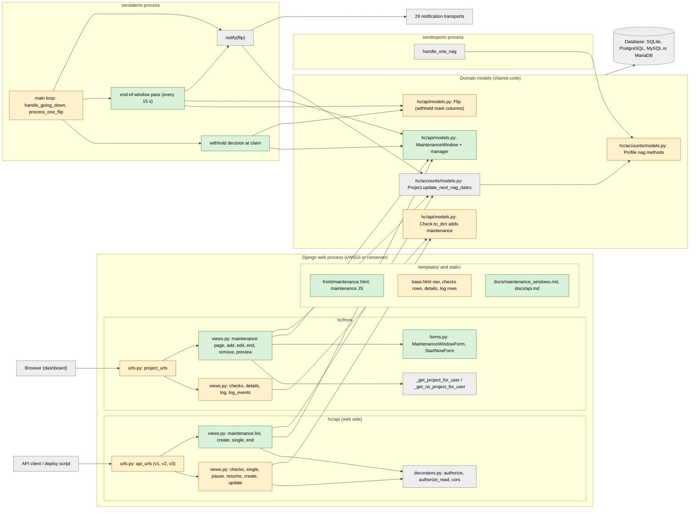
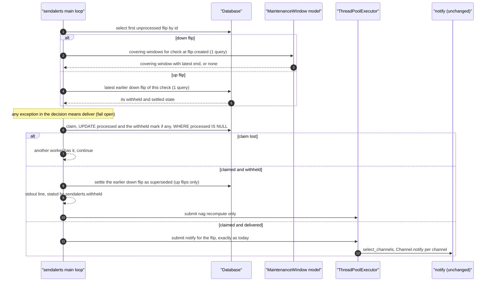
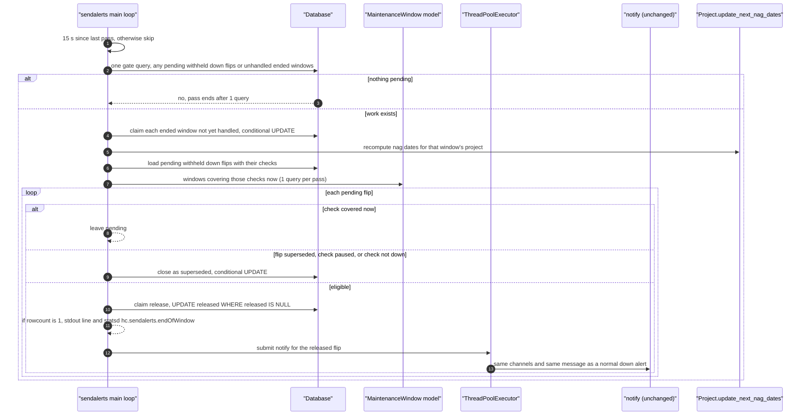
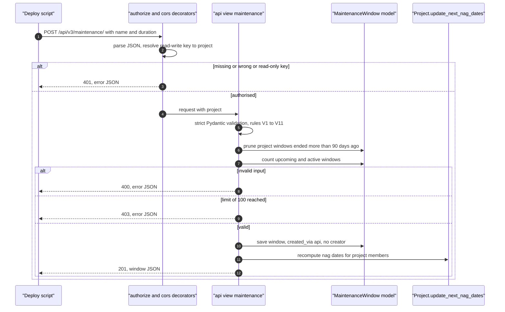
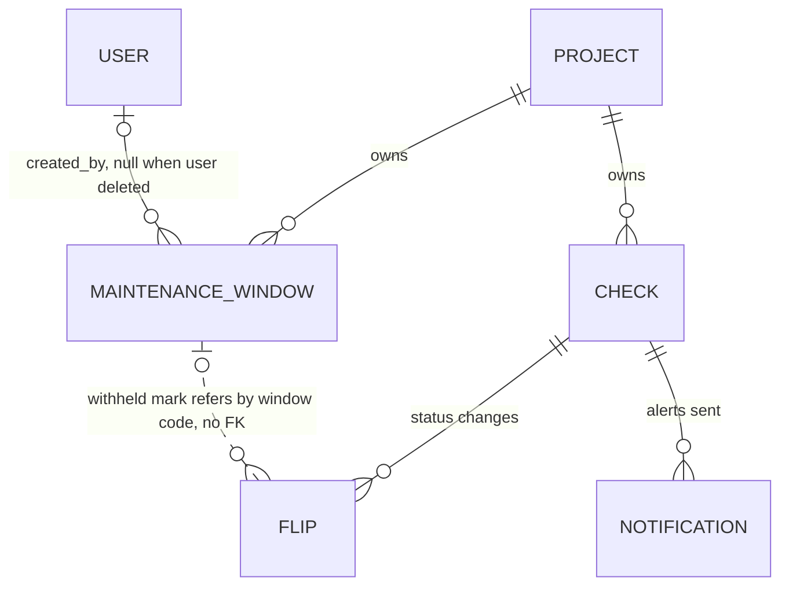

# High-Level Design: maintenance windows

Inputs: `planning/01-brief.md` (REQ-1…REQ-6, NFR-1…NFR-5, A1–A10, R1–R8), `planning/02-prd.md` (REQ-n.m, NFR-n.m, V1–V11, DECISION-1…15), `planning/decisions-log.md` (Q1–Q7), `.forge/repo-map.json`, `.forge/brief.json` (`has_user_interface: true`, `has_api: true`, both confirmed by this design). Code citations are to the tree at commit `ca8b9c03`.

**Existing architecture style: a Django modular monolith with fat models and a database-backed outbox worker.** One deployable Django project (`hc/urls.py:16-51` mounts every app into one URLconf). Apps split by concern: `hc/accounts` (users, projects, members), `hc/api` (core domain models, the REST API, the `sendalerts`/`sendreports` workers), `hc/front` (every dashboard view, no models of its own), `hc/logs`, `hc/payments`, and 30 `hc/integrations/<kind>` plugin apps. There is no service layer. Domain logic lives on models (`Check.get_status`, `Flip.select_channels`, `Profile.update_next_nag_date`, `hc/api/models.py:1390-1408`, `hc/accounts/models.py:350-357`). Views call the models directly. Asynchronous work goes through rows in the shared database. A status change inserts a `Flip`, and the long-running `manage.py sendalerts` process claims each flip with a conditional UPDATE and then delivers it (`hc/api/management/commands/sendalerts.py:105-121`). There is no message broker, no cache, and no second service.

**Where this change sits:** inside that style. It adds no new app, process, or store. The new entity `MaintenanceWindow` goes next to `Check` and `Flip` in `hc/api/models.py`, with its rules written as model methods and a custom manager. The REST endpoints go into `hc/api/views.py` and the shared `api_urls`. The dashboard views go into `hc/front/views.py`, `hc/front/forms.py` and the project URL list. Alert withholding and the end-of-window pass are two steps added to the existing `sendalerts` loop. The style needs no deviation (ADR-001).

---

## Context and Goals

Today the only way to keep alerts quiet during planned work is to pause each check by hand. A pause cannot be scheduled and has no time limit. Resuming resets the check to `new` (`hc/api/views.py:574-590`). This change adds the **maintenance window**: a named one-off period `[start, end)` that belongs to one project and covers either *all checks* or *checks with all of these tags* (Q1=B, Q2=A). During a window, `sendalerts` withholds the notifications for covered checks. Statuses, pings, flips, badges, metrics and downtime stay exactly as they are (REQ-2, Q5=A). When the last covering window ends and a check is still down with its alert withheld, one down alert goes out (REQ-3, Q3=A). Covered checks are left out of nags (REQ-4). Windows are managed on the dashboard (REQ-1, REQ-5) and through the REST API (REQ-6, Q4=B).

| Users | What changes for them |
|---|---|
| Project owner, Manager, Member (writers) | Maintenance page: schedule, start now, edit, end now, delete (REQ-1) |
| Read-only members | See the Maintenance page and labels. Every write returns 403 (REQ-1.15) |
| Deploy scripts with the read-write key / read-only key | `/api/v{1,2,3}/maintenance/…` writes / reads (REQ-6) |
| On-call people on any of the 29 transports | No alerts for covered checks during a window. One unchanged down alert at the end if still down (REQ-2, REQ-3.11) |

**Design goals, in priority order**
1. **G4 / R1: no change for anyone without windows.** With 0 windows the alert path, the nag path and the query counts behave exactly as today.
2. **G3: no lost failure.** Withheld down alerts are released at least once and at most once, also across restarts and with 2 workers (REQ-3.5, REQ-3.6).
3. **G2: monitoring is untouched.** Windows affect only the notification and nag decisions. They never touch status computation.
4. **Fit.** Reuse every existing mechanism: the flip claim, the access helpers, the auth decorators, Django forms and Pydantic, `notify()`, `update_next_nag_dates()`, inline pruning.

## Quality Scenarios

| ID | Quality | Scenario (source, stimulus, environment) | Response and measure | Priority |
|---|---|---|---|---|
| QS-1 | Regression safety | A flip of any check is processed by `sendalerts` in a database with 0 windows | Delivered exactly as today. The existing `test_sendalerts`, `test_notify`, `test_flip_model`, `test_sendreports` and `test_profile_model` tests pass unchanged, including `statsd.incr.assert_called_once()` (`hc/api/tests/test_sendalerts.py:78`) | Must |
| QS-2 | Performance | A client lists 500 checks (`GET /api/v3/checks/`, `/projects/<code>/checks/`) | 0 extra queries with no active window in the project (the existing `assertNumQueries(3)` at `hc/api/tests/test_list_checks.py:47` keeps passing). At most 1 extra query otherwise (NFR-1.1 allows 2) | Must |
| QS-3 | Reliability | Two `sendalerts` processes run when a withheld down flip becomes eligible for release | Exactly 1 `Notification` per selected channel (REQ-3.6, NFR-2.2) | Must |
| QS-4 | Reliability | `sendalerts` was stopped when a window ended and starts 2 h later | The released alert goes out within 60 s of the start, exactly once (REQ-3.5) | Must |
| QS-5 | Fault tolerance | The coverage evaluation raises an exception for a flip | The exception is logged and the flip is **delivered** (fail open, NFR-2.3, DECISION-14) | Must |
| QS-6 | Performance | `sendalerts` idles with 0 windows and 0 pending withheld flips | The end-of-window pass costs ≤1 query per run and runs every 15 s, so ≤0.07 queries/s (NFR-1.3, REQ-3.13) | Must |
| QS-7 | Security | A member of project P requests a window of project Q through the dashboard, or P's API key is used on Q's window | 404 on the dashboard (REQ-1.17), 403 on the API (REQ-6.13). No window data in the body | Must |
| QS-8 | Determinism | A down flip created inside a window is processed 1 h later, after the window was ended early | Still withheld, because coverage is evaluated at `flip.created` (REQ-2.11, NFR-2.1) | Must |
| QS-9 | Accessibility | A keyboard-only user schedules a window in the dark theme | All controls reachable. The label has text and contrast ≥4.5:1 (NFR-4.1, NFR-4.2) | Must |

## Constraints and Assumptions

**Constraints (from the code and the brief)**
- C-1. Four database engines in CI: SQLite, PostgreSQL, MySQL and MariaDB, on Python 3.12–3.15 (`.github/workflows/tests.yml`). Migrations must be additive and portable (REQ-7.2).
- C-2. `mypy --strict hc` with the django-stubs plugin. The only error allowed is the existing one at `hc/settings.py:451` (SC-4).
- C-3. The `CHANGELOG.md` heading format is load-bearing, because `settings.VERSION` is parsed from it (`hc/settings.py:85-89`).
- C-4. No new runtime dependency and no new JS library. jQuery and Bootstrap 3 are already vendored in `static/` (NFR-11.1).
- C-5. No new management command, cron job, or process (Q6=A, ADR-004).
- C-6. The JSON shapes of `checks/status/`, `/flips/`, badges and metrics are frozen. The only additive change is the `"maintenance"` key in check JSON (REQ-6.15, REQ-7.3).

### Assumptions
- AH-1. Flips are claimed in primary-key order, because `Flip.objects.filter(processed=None).first()` (`sendalerts.py:105`) orders by `pk` when no ordering is given (Django `QuerySet.first()` semantics). ADR-007 relies on this for down/up ordering within one process.
- AH-2. On MySQL and MariaDB, Django does not create conditional (partial) indexes. The existing `api_flip_not_processed` partial index (`hc/api/models.py:1372-1376`) already lives with this limit. The new pending-release partial index inherits the same limit, and is acceptable because the pending set is tiny (ADR-006).
- AH-3. Django 6.1's `ALTER TABLE … ADD COLUMN` path is used for nullable columns with no default on all four engines, so adding columns to `api_flip` does not rewrite the table. This is unverified on SQLite with a foreign-key column, which is one reason ADR-006 uses no FK. LLD must confirm it with `sqlmigrate`.
- AH-4. Windows per project stay small (≤100 upcoming+active, V10). In-Python tag matching over the active windows of one project or one user's projects is cheap.
- AH-5. Brief A1–A10 and PRD AS-1…AS-12 hold as written.

## Architecture Style

**Kept: a Django modular monolith, fat models, a database-row outbox worker** (ADR-001, with the existing decisions behind it written down retroactively in ADR-002, ADR-003, ADR-004 and ADR-005). The drivers that make this the right home and rule out anything new:
- The feature changes a decision made *inside* the existing alert pipeline (`sendalerts` → `notify` → `Flip.select_channels`). Running the decision anywhere else would need a second delivery path. QS-1 and QS-3 forbid that.
- Every new interaction is one more case of something the repo already does. Project-scoped dashboard CRUD follows the `hc/front` badges and integrations pages. Key-authenticated JSON endpoints follow `hc/api/views.py`. A conditional-UPDATE claim follows `sendalerts`. Inline pruning follows `Check.prune()`.
- One process model, one store, one URLconf. Local run and deployment stay unchanged.

**Rejected: a new `hc/maintenance` Django app.** It would reduce merge conflicts with upstream (R7), but core domain entities live in `hc/api/models.py`. Standalone apps in this repo are transports (`hc/integrations/<kind>`) or infrastructure (`hc/logs`, `hc/payments`). A maintenance window belongs to the alerting domain and is read by `Flip`, `Check.to_dict`, `sendalerts` and `Profile`.

## System Context

The actors and external systems are unchanged: browsers, API clients, the 29 notification transports, SMTP, optional S3. No new external integration is added (W4: no notifications on window start or end). The only new traffic is browser requests to `/projects/<code>/maintenance/…` and API-client requests to `/api/v{1,2,3}/maintenance/…`. Both cross the existing trust boundaries through the existing authentication (see Security Model).

## Building Blocks

Legend: green = new, amber = changed, grey = unchanged. The blast radius is the amber and green nodes.

`notify()` (`sendalerts.py:24-55`) and `Flip.select_channels` (`hc/api/models.py:1390-1408`) are deliberately **unchanged**. The withhold decision runs before a flip is handed to `notify()`, and a released flip is passed to the same `notify()` (ADR-007, ADR-008). `Project.update_next_nag_dates` (`hc/accounts/models.py:488-499`) is unchanged and reused. Only `Profile.update_next_nag_date` and `Profile.send_report(nag=True)` change.

### Placement of each responsibility

| Responsibility (requirement) | Lives in | Same way the repo already does |
|---|---|---|
| Window entity, state (upcoming/active/ended), "covers check at t", active windows for a set of projects, to-JSON, prune ended >90 d (REQ-1, REQ-2, REQ-5.11, REQ-6) | `MaintenanceWindow` model and its custom manager in `hc/api/models.py` | `Flip.select_channels`, `ProfileManager.for_user` and `ProjectManager.for_api_key` (`hc/accounts/models.py:61`, `:397`), `Check.prune` (ADR-002, ADR-004) |
| Withheld mark on a flip (REQ-2.1, REQ-3) | Nullable columns on `Flip` (ADR-006) | `Flip.processed` |
| Withhold decision (REQ-2.1–2.7, 2.10–2.13) | `sendalerts.Command.process_one_flip`, which calls model methods (ADR-007) | The claim at `sendalerts.py:110-116` |
| End-of-window release and nag recompute (REQ-3, REQ-4.4) | A new `Command` method called from the `sendalerts` main loop at most every 15 s (ADR-008) | `handle_going_down`, a conditional UPDATE claim |
| Nag exclusion (REQ-4.1–4.3, 4.5) | `Profile.update_next_nag_date`, `Profile.send_report(nag=True)` | The same methods, extended |
| `"maintenance"` key (REQ-6.15) | `Check.to_dict`, fed by a batched coverage lookup (ADR-009) | `to_dict`'s existing manual URL construction that avoids per-check queries (`hc/api/models.py:464-480`) |
| Dashboard pages and actions (REQ-1, REQ-5) | `hc/front/views.py`, `hc/front/forms.py`, `hc/front/urls.py` `project_urls`, `templates/front/`, `static/js/` | badges and integrations pages, `_get_rw_project_for_user`, `NameTagsForm` |
| Label and withheld text (REQ-5.1–5.3) | `templates/front/` partials for check rows, details and log rows. Names resolved in the views | `_get_events` consumers |
| REST endpoints (REQ-6) | `hc/api/views.py` + `api_urls`, with a Pydantic spec validated with `strict=True` | `create_check`, `pause`, `resume`, `delete_check`, `Spec` |
| Docs (REQ-6.16) | `templates/docs/api.md`, new `templates/docs/maintenance_windows.md`, `.html-fragment` pairs via `render_docs` | the existing docs pages |
| OpenAPI contract (REQ-6.17, Q7=A) | `planning/api/openapi.yaml`, new endpoints only. A planning artifact, not served (ADR-010) | Nothing exists today (`api_spec: null`) |

### Change impact

Every module, route, table and integration touched, with the existing tests that cover it today. The "Existing tests" column is what must keep passing unchanged (counts are `def test_` occurrences).

| Area | What changes | Requirements | Existing tests covering it |
|---|---|---|---|
| `hc/api/models.py`: new `MaintenanceWindow` | New model, manager, JSON serialiser, prune | REQ-1, 2, 5.11, 6 | none (new) |
| `hc/api/models.py`: `Flip` | +3 nullable columns, +1 partial index. `to_dict`/`FlipDict` unchanged | REQ-2.1, 3.x | `hc/api/tests/test_flip_model.py` (10), `test_get_flips.py` |
| `hc/api/models.py`: `Check.to_dict` | Adds `"maintenance": bool`, optionally fed a precomputed value | REQ-6.15 | `test_get_check.py` (10), `test_list_checks.py` (11, incl. `assertNumQueries(3)` and `(2)`), `test_create_check.py`, `test_update_check.py`, `test_pause.py` (11), `test_resume.py` (9), `test_delete_check.py`, `test_check_model.py` (31) |
| `hc/api/models.py`: `Check.prune` | **No change.** Flip deletion stays a fast delete, because no table gets an FK to `Flip` (ADR-006) | — | `test_ping_model.py`, `test_check_model.py` |
| `hc/api/management/commands/sendalerts.py` | Withhold decision in `process_one_flip`. New end-of-window pass method. New stdout lines and statsd counters. `notify()` unchanged | REQ-2, 3, 4.4, NFR-5 | `test_sendalerts.py` (10), `test_notify.py` (2), the transport tests under `hc/integrations/*/tests` (exercise `notify` content) |
| `hc/api/management/commands/sendreports.py` | No code change expected. Behaviour changes through `Profile.send_report(nag=True)` | REQ-4.2, 4.3 | `test_sendreports.py` (11) |
| `hc/accounts/models.py`: `Profile.update_next_nag_date`, `Profile.send_report` | Exclude checks covered now | REQ-4.1–4.5 | `test_profile_model.py` (18), `test_notifications.py`, `test_unsubscribe_reports.py`, `test_sendalerts.py` nag tests (lines 100-174) |
| `hc/accounts/models.py`: `Project` | Reverse relation `maintenancewindow_set` only. No schema change | — | `test_project_model.py` (5) |
| `hc/api/views.py` + `hc/api/urls.py` | 3 new routes (5 operations). Check-JSON responses gain the key | REQ-6 | `test_list_checks.py`, `test_get_check.py`, `test_auth.py`, `test_create_check.py`, `test_pause.py`, `test_resume.py`, `test_delete_check.py`, `test_update_check.py` |
| `hc/front/views.py`: `checks`, `details` | Compute covered checks with one batched lookup. Pass label data to templates | REQ-5.3 | `test_basics.py` (5), `test_my_checks.py`, `test_details.py` (20) |
| `hc/front/views.py`: `log`, `log_events`, `details` events | Resolve window names for withheld flips on the page (0 queries when there are none). `_get_events` itself unchanged | REQ-5.1, 5.2 | `test_log.py` (12), `test_log_events.py` (16), `test_get_events.py` (4, with `assertNumQueries` that must not move) |
| `hc/front/views.py` + `forms.py` + `urls.py`: new maintenance views | 6 new routes under `/projects/<code>/maintenance/` | REQ-1, 5.4–5.8 | none (new) |
| `templates/base.html` | "Maintenance" nav item next to Checks, Integrations, Badges (`templates/base.html:121-137`) | REQ-1.1 | `test_basics.py`, every page test that renders `base.html` |
| `templates/front/checks.html`, `details.html`, `log.html`, event-row partials | Label and withheld text | REQ-5.1–5.3 | `test_basics.py`, `test_details.py`, `test_log.py`, `test_log_events.py` |
| `static/css`, `static/js` | New maintenance JS (form, preview, start-now). Label CSS for light and dark themes | REQ-1.6, 5.7, NFR-4 | none (repo has no JS tests) |
| `templates/docs/*.md` + `.html-fragment` | `api.md` sections, new `maintenance_windows.md`, link from `configuring_notifications.md` | REQ-6.16 | `hc/front/tests/test_serve_doc.py` |
| `search.db` (tracked docs search index) | Regenerate with `manage.py populate_searchdb` so the new page is searchable | REQ-6.16 | `hc/front/tests/test_search.py` |
| Tables | New `api_maintenancewindow`. `api_flip` +3 nullable columns, +1 partial index | Data model | migrations check (`makemigrations --check`) |
| Integrations (29 transports) | **No change.** A released alert is an ordinary down flip sent through `notify()` | REQ-3.11 | `hc/integrations/*/tests` (84 files) |
| `CHANGELOG.md` | One bullet under `## v4.5-dev - Unreleased` | REQ-7.1 | `settings.VERSION` parse (used site-wide) |

Not touched: `Check.get_status`/`going_down_after`/`ping`, `handle_going_down`, pause/resume (`hc/api/views.py:547-591`, `hc/front/views.py:824-868`), badges, metrics, `checks/status/`, flapping notices, monthly and weekly reports, every transport.

### Backward compatibility

| Promise (brief "Compatibility promises") | How the design keeps it |
|---|---|
| Status values and every status-derived output (badges, metrics, `status` in JSON, `/flips/`) | Windows never write `Check.status`, `alert_after`, pings or flips. They are read only at notification and nag time (G2) |
| JSON shapes | `FlipDict`/`Flip.to_dict` are unchanged even though `Flip` gets columns. Check JSON gains only `"maintenance"`, for v1, v2 and v3 (A4). `checks/status/` JSON is unchanged (DECISION-7) |
| URLs and URL names | Routes are only added: `hc-maintenance`, `hc-add-maintenance`, `hc-edit-maintenance`, `hc-end-maintenance`, `hc-remove-maintenance`, `hc-maintenance-preview`, `hc-api-maintenance`, `hc-api-maintenance-single`, `hc-api-maintenance-end`. No existing pattern is reordered |
| `sendalerts` claim semantics | The conditional UPDATE on `processed` is unchanged. The decision only adds a branch after a successful claim. Uncovered flips take today's code path, with no new statsd call on that path (QS-1) |
| Pause/resume | Untouched. Their flips are `mark_as_processed=True` and never reach the decision (REQ-2.12) |
| Data | Additive migrations only (see Data Overview). No backfill. Every existing flip reads as "not withheld" |
| Query counts | 0 extra queries on list endpoints when the project has no active window (ADR-009) |

**Breaking changes: none.** The one observable change for existing API clients is the additive `"maintenance"` key. Clients that reject unknown keys are the only ones affected. `api.md` documents the key, and the CHANGELOG line names it.

### Existing patterns this change reuses, and the one thing it introduces

| Need | Existing pattern reused | Where it already lives |
|---|---|---|
| Domain rules | Fat model + custom manager (ADR-002) | `Check`, `Flip.select_channels`, `ProfileManager`, `ProjectManager` |
| Exactly-once claims across workers | Conditional UPDATE + rowcount check (ADR-003) | `sendalerts.py:110-116`, `:164-168`, `sendreports.py:78-82` |
| Retention | Inline, per-owner pruning on normal traffic (ADR-004) | `Check.prune()` (`hc/api/models.py:575-603`) |
| API surface and auth | `@cors` + `@csrf_exempt` + `@authorize`/`@authorize_read`, `error(msg, status)`, `HttpResponseForbidden` for other projects' objects, `get_object_or_404` | `hc/api/decorators.py:33-118`, `hc/api/views.py:521-590` |
| API versioning | One view set under three prefixes (ADR-005) | `hc/api/urls.py:79-81` |
| API input validation | Pydantic v2 model, `model_validate(strict=True)`, `format_first_error` messages | `hc/api/views.py:61` `Spec` |
| Dashboard access | `_get_project_for_user` (404) / `_get_rw_project_for_user` (403) | `hc/front/views.py:172-194` |
| Dashboard input | Django `forms.Form` subclasses | `hc/front/forms.py` |
| Dashboard writes | `@require_POST` + `@login_required` + CSRF | `hc/front/views.py:529-560` |
| Previews over XHR | A small view that returns a fragment or JSON | `cron_preview`, `oncalendar_preview` (`hc/front/views.py:677-717`) |
| Nag recompute | `Project.update_next_nag_dates()` | `hc/accounts/models.py:488-499`, called from `pause` (`hc/front/views.py:843`) |
| Metrics, logging | `statsd.incr`, `logger = logging.getLogger("hc")`, stdout lines in `sendalerts` | `sendalerts.py:21`, `:38-55` |
| Docs | Markdown + `render_docs` fragment pair | `templates/docs/` |

**Introduced, because nothing existing does the job:**
1. **A periodic step inside `sendalerts` that is not driven by a single row's timestamp** (the end-of-window pass, ADR-008). `handle_going_down` is driven by `Check.alert_after`. A release depends on "no window covers the check now", which changes with window edits and tag edits, not with a single timestamp. The pass reuses the loop, the claim pattern and `notify()`. Only its trigger (a 15 s interval with a single gate query) is new.
2. **A machine-readable OpenAPI document** (ADR-010). Its scope is the new endpoints only (Q7=A). It is a planning artifact, and `api.md` stays the public documentation.

## Key Flows

### Flow 1: a flip during a window (REQ-2.1–2.7, 2.10, 2.13, QS-5, QS-8)

The decision is read-only and runs before the claim. The claim then writes `processed` and, when withheld, the mark in one conditional UPDATE, so a flip is never claimed without its mark (ADR-007). With 0 windows, the cost is the one read that finds nothing, and the claim is today's claim. The coverage rule ("covers check C at t") compares `start` and `end` with `flip.created`, never with now. A delayed or restarted worker therefore makes the same decision (NFR-2.1). Windows of the check's *current* project and tags are used (PRD vocabulary, AS-3, AS-4).

### Flow 2: end-of-window pass (REQ-3.1–3.10, 3.12, 3.13, REQ-4.4, QS-3, QS-4, QS-6)

The release claim has the same guarantee as today's flip claim: the claim commits before `notify` runs. A crash between the two loses that one alert, and a second worker can never send it twice (NFR-2.2). Release eligibility is "not covered now" (DECISION-6). End now, a shortened end, a tag edit, a project transfer and a missed end time while `sendalerts` was down all go through this one rule.

### Flow 3: create a window through the API (REQ-6.3–6.6, REQ-5.11, REQ-1.20)

The dashboard create flow is the same, with `_get_rw_project_for_user`, a Django form in `Profile.tz`, and a 302 to the Maintenance page instead of JSON.

## Data Overview

| Entity | Owner (app) | Change |
|---|---|---|
| `MaintenanceWindow` **(new)** | `hc/api` | New table `api_maintenancewindow`. FK `project` CASCADE, FK `created_by` SET_NULL, `code` UUID unique, `name`, `start`, `end`, `tags`, `created`, `created_via` (PRD data model), plus one internal nullable timestamp "end handled" used by the end-of-window pass to claim each ended window once for the nag recompute (ADR-008). Index on `(project, end)` for "not yet ended in P" and pruning |
| `Flip` **(changed)** | `hc/api` | +3 nullable columns, no defaults: withheld time (non-null means withheld), withheld window code (UUID, no FK, null for up flips withheld outside any window when the earlier mark has none), and a release/settle record that tells *released* (alert sent) apart from *superseded* (closed without an alert). +1 partial index on pending withheld down flips. Exact names and types are for LLD (ADR-006) |
| `Check` | `hc/api` | No schema change. `to_dict` gains a computed key |
| `Notification` | `hc/api` | None. Released alerts are ordinary `check_status="down"` rows |
| `Project`, `Profile`, `Member`, `User` | `hc/accounts` / Django | No schema change |

**Window ↔ check coverage is computed, never stored** (ADR-009). The project and tag rules plus `[start, end)` decide it at read time. That keeps tag edits, check creation and project transfer correct with no synchronisation code.

**Withheld mark lifecycle (down flips):** pending (withheld, not settled) → *released* (alert sent by the pass) or *superseded* (a later flip overtook it, or the check was paused when the pass looked). Up flips are withheld and settled at once. Recording "superseded" is not observable in the UI or API. It exists so that the pending set, and the gate query, stays near zero, instead of growing with every withheld flip whose check later recovered or was paused (REQ-3.2, REQ-3.9). It does not change any PRD-visible behaviour.

### Migration plan (expand only. Nothing in this release removes or reshapes existing data)

| Step | Migration (app `api`, after `0123_alter_channel_kind`) | Reversible | Lock and volume note |
|---|---|---|---|
| 1 | Create `api_maintenancewindow` with its indexes | Yes (drop table) | New empty table |
| 2 | Add 3 nullable, default-less columns to `api_flip` | Yes (remove fields) | Metadata-only `ADD COLUMN` on PostgreSQL ≥11 and MySQL 8. Unverified for SQLite (AH-3) |
| 3 | Add the partial index for pending withheld down flips | Yes (drop index) | Builds over `api_flip` once. On PostgreSQL it holds a write lock for the build, the same as every index this repo has added before (no `CONCURRENTLY` precedent). Not created on MySQL/MariaDB (AH-2) |

There is no data migration and no contract step. If the feature is ever removed, the contract step (dropping columns and table) would be a later release, after the code stops reading them. `makemigrations --check --dry-run` must stay "No changes detected" (REQ-7.2, NFR-9.2).

## Deployment

**Deployment is unchanged.** The same processes run: the web process (uWSGI in `docker/uwsgi.ini`, `runserver` locally), `manage.py sendalerts`, `manage.py sendreports --loop`, `manage.py smtpd`. The database, environment variables, ports and volumes are the same. There is no new process, command, scheduled job, setting or environment variable (C-5). No diagram is given, because it would only restate the existing deployment. Operators get one migration on upgrade (`manage.py migrate`, as for any release).

### Local run, unchanged in one command
`.venv/bin/python manage.py migrate && .venv/bin/python manage.py runserver` (from `.forge/stack.json`, verified by Discovery). The feature needs nothing else to be visible on the dashboard. To see alerts withheld and released, run `.venv/bin/python manage.py sendalerts` beside it, the same as for any alert today.

## Security Model

The trust boundaries are unchanged: browser → Django session auth; API client → project API key; worker → database. This change adds routes only behind those existing gates, so no new boundary diagram is needed.

| Concern | Enforcement (existing mechanism) | Requirement |
|---|---|---|
| Dashboard authentication | `@login_required` on every maintenance view | REQ-1.16 |
| Dashboard authorisation | Reads: `_get_project_for_user` (404 for non-members). Writes: `_get_rw_project_for_user` (403 for read-only). The window is looked up with `project=` in the filter, so a window from another project is 404 even for a member of both (REQ-1.17). Controls are hidden when `rw` is false | REQ-1.15–1.17, NFR-3.1 |
| CSRF | Django CSRF on every dashboard POST. API views are `@csrf_exempt` and key-authenticated, as today | NFR-3 |
| API authentication | `@authorize` (writes, read-write key only) and `@authorize_read` (reads, either key). Unchanged decorators, unchanged 401 messages | REQ-6.12 |
| API object authorisation | `get_object_or_404(MaintenanceWindow, code=…)` then `HttpResponseForbidden()` if `window.project_id != request.project.id`, matching `pause`/`single` (`hc/api/views.py:548-550`) | REQ-6.13 |
| Input validation | Django forms (dashboard) and a strict Pydantic model (API) carry V1–V11. Tags are normalised before storage. The preview endpoint validates `tags` length before matching | NFR-3.2 |
| Output safety | Names and tags are rendered only through auto-escaping templates. Preview JSON is inserted as text by the JS, never as HTML. No `mark_safe`/`|safe` on window fields | REQ-5.9, NFR-3.3 |
| Privacy | Creator email appears only in dashboard templates for project members. The window JSON serialiser has no creator field | REQ-6.14, NFR-8.1 |
| Abuse limits | 100 upcoming+active windows per project and 30-day maximum length, enforced in both paths through one shared model-level rule set | REQ-1.5, REQ-6.6, R6 |
| Secrets | None introduced | Baseline |

## Cross-Cutting Decisions

- **Identity and access:** existing session auth, team roles and API keys only. No new role or permission (see Security Model).
- **Input and output safety:** forms and strict Pydantic in, auto-escaped templates out. A single model-level validator holds the rules shared by both paths (V5–V7, V10), so the dashboard and the API cannot drift apart (R6).
- **Configuration:** no new setting. The 100-window limit, the 30-day maximum, the 90-day retention and the 15 s pass interval are module constants, the same way `Check.prune` hard-codes 93 days (`hc/api/models.py:602`).
- **Time:** stored in UTC. The dashboard converts to and from `Profile.tz` with `zoneinfo` (fold=0 for ambiguous times, nonexistent times rejected, REQ-1.18). The API requires an explicit offset (V2). Microseconds are dropped (REQ-6.4).
- **Error handling:** API `error(msg, status)` JSON, 409 with a JSON body for state conflicts (DECISION-9). Dashboard form errors re-render with 200, and state errors return 400. In `sendalerts`, the decision and the pass fail open: any exception is logged with `logger.exception` and the flip is delivered (decision) or left pending for the next pass (release). The loop never crashes because of this feature (NFR-2.3).
- **Data integrity and migrations:** expand-only, reversible, portable across four engines. Every cross-worker state change is a conditional UPDATE with a rowcount check (ADR-003).
- **Observability:** statsd `hc.sendalerts.withheld` and `hc.sendalerts.endOfWindow`. Stdout lines in the existing `"<code> goes <status>"` style (REQ-2.13, REQ-3.12). Errors go through the `hc` logger, which `hc.logs.Handler` persists.
- **Performance:** coverage for lists is one EXISTS annotation on the existing checks query, plus at most one window fetch when any check's project has an active window (ADR-009). `sendalerts` adds ≤1 read per flip. The mark rides on the existing claim UPDATE, plus ≤1 write to settle an earlier down flip when an up flip is withheld (NFR-1.2). The pass costs ≤1 query when idle (QS-6). The nag path adds 0 queries when the user has no down checks and ≤1 otherwise (NFR-1.5).
- **Reliability:** decisions depend on `flip.created` and stored window intervals only (NFR-2.1). Releases follow the at-least-once / at-most-once claim discipline (NFR-2.2).
- **Testability:** every time-dependent rule takes "now" from `django.utils.timezone.now`, so `time-machine` (already pinned, `requirements-dev.txt:7`) controls it.
- **Operability:** no new job to schedule. The retention cleanup happens inline (Q6=A).
- **Accessibility:** the label is text plus an icon, with an accessible name. Forms use `<label>` and `aria-describedby` for errors. Modals follow the existing Bootstrap 3 modal pattern with focus return (NFR-4).

### Testing strategy (matches existing conventions)

- **Runner and style:** `manage.py test` (Django test runner). `hc.test.BaseTestCase` subclasses (fixtures `alice`, `bob`, `charlie`, `self.project` with key `"X" * 32`). Files `test_<feature>.py`, methods `test_it_<behaviour>`, `time_machine.travel` for time (NFR-9.3). Use `TransactionTestCase` only where the existing tests already need it (`test_notify.py`).
- **New test files** (names follow the existing per-endpoint files such as `test_create_check.py` and `test_pause.py`):
  - `hc/api/tests/`: `test_maintenance_model.py` (states, covers, tag matching, overlap, start inclusive / end exclusive, prune), `test_sendalerts_maintenance.py` (withhold, REQ-2.6, fail open, release, two-worker claim simulated by pre-claiming, missed end, End now, tag removal, paused/deleted, idle query count), `test_list_maintenance.py`, `test_create_maintenance.py`, `test_get_maintenance.py`, `test_end_maintenance.py`, `test_delete_maintenance.py` (each run on v1, v2 and v3, NFR-11.2).
  - `hc/front/tests/`: `test_maintenance.py` (page, sections, permissions), `test_add_maintenance.py`, `test_edit_maintenance.py`, `test_end_maintenance.py`, `test_remove_maintenance.py`, `test_maintenance_preview.py`.
  - Additions to existing files: `hc/accounts/tests/test_profile_model.py` (nag exclusion), `hc/api/tests/test_sendreports.py` (all-covered nag), `hc/api/tests/test_list_checks.py` and `test_get_check.py` (`"maintenance"` key, query counts with 0, 1 and 50 windows), `hc/front/tests/test_log.py` / `test_details.py` / `test_basics.py` (label, withheld text, escaping).
- **Characterization tests to add *before* changing behaviour** (gaps found in the touched code):
  1. `Profile.update_next_nag_date` where the user's down checks span two projects. Today the test file covers single-project cases only (`test_profile_model.py`). Pin the current set/clear behaviour before excluding covered checks.
  2. `sendalerts.process_one_flip` with two unprocessed flips for the same check (down then up). Pin that the lower id is claimed first (AH-1), because ADR-007 relies on it.
  3. Query counts for `GET /api/v3/checks/<uuid>` and `/projects/<code>/checks/`. Only the list API pins a count today (`test_list_checks.py:47`). Pin the current numbers so NFR-1.1 is measured against a recorded baseline.
  4. `Check.prune()` deletes flips with a single DELETE (no per-row collection). Pin it with `assertNumQueries` so that a later FK to `Flip` cannot silently turn the prune into a collect-then-delete (ADR-006).
- **Regression gate:** the full existing suite (1769 tests) passes unchanged on SQLite locally and on the four CI engines. `mypy --strict hc` shows only the known error. `makemigrations --check --dry-run` is clean.
- **Not automated (repo has no JS or browser tests):** the preview JS, the modals and keyboard flows are checked by hand against NFR-4.1 and NFR-11.1 at the gate. This is the same gap the repo has today (`.forge/repo-map.json` `tests.gaps`).

## Stack

Verified in this environment on 2026-10-17: `.venv/bin/python --version` → 3.12.3. `import django, time_machine, pydantic` → Django 6.1.2, Pydantic 2.14.1. `.venv/bin/mypy --version` → 2.4.0. `manage.py test hc.api.tests.test_sendalerts hc.api.tests.test_notify hc.api.tests.test_flip_model hc.api.tests.test_sendreports` → 33 tests OK.

| Concern | Choice | Version | Why (one line) | ADR |
|---|---|---|---|---|
| Language | Python | 3.12.3 (.venv); CI 3.12–3.15 | Existing | ADR-001 |
| Web framework | Django (templates + JSON views) | 6.1.2 | Existing, no new framework | ADR-001 |
| API validation | Pydantic v2, strict | 2.14.1 | Existing `Spec` pattern | ADR-005 |
| Worker | `manage.py sendalerts` loop | — | Existing outbox worker, extended | ADR-003, ADR-007, ADR-008 |
| Database | SQLite (local), PostgreSQL/MySQL/MariaDB (CI and production) | per `requirements.txt` | Existing, unchanged | ADR-006 |
| Front end | Server-rendered templates, jQuery 3.6.0, Bootstrap 3 (vendored) | vendored | Existing, no new JS dependency (NFR-11.1) | ADR-001 |
| Tests | Django test runner + `time-machine` | time-machine 3.5.1 | Existing conventions | — |
| Type checking | mypy `--strict` + django-stubs | mypy 2.4.0 | Existing CI gate | — |
| API contract | OpenAPI 3.1 YAML (planning artifact only) | 3.1 | Pipeline requirement, scoped by Q7=A | ADR-010 |

## Risks and Open Questions

Regression risks first.

| ID | Risk / question | Owner phase | Proposed resolution |
|---|---|---|---|
| RK-1 (R1) | **Alert delivery regresses for users without windows.** The decision runs on every flip | Implementation, Review | The deliver path stays byte-for-byte today's code, with no new statsd call or stdout line. The decision fails open (QS-5). With 0 windows, a down flip costs 1 indexed query that finds nothing. Characterization tests 2 and 4. The existing `test_sendalerts` passes unchanged |
| RK-2 (R4) | **Nag dates change for everyone.** `update_next_nag_date` runs for every flip's project | Implementation | Keep `exists()`-equivalent behaviour when the user has no down checks (0 extra queries). Only when down checks exist, fetch the active windows of their projects in 1 query. Characterization test 1. REQ-4.5 test with 0 windows |
| RK-3 (R5, NFR-1) | **Query count growth** on list pages and the API | Implementation | EXISTS annotation plus at most 1 fetch (ADR-009). Pinned counts (characterization test 3). The existing `assertNumQueries(3)` must pass unchanged |
| RK-4 | **`Check.prune` slows down** if anything gets an FK to `Flip` | LLD, Review | ADR-006 forbids an FK to `Flip`. Characterization test 4 guards it |
| RK-5 (R2) | **Lost or duplicate end-of-window alerts** | Implementation | Conditional-UPDATE claim on the release, and on each ended window for nags. A test simulates the second worker by claiming first and asserting 0 sends. A crash between claim and send loses at most one alert, the same as today (NFR-2.2) |
| RK-6 | **Two `sendalerts` processes handle the down flip and the up flip of one check within milliseconds of each other.** The up flip's look-back can then run before the other process's claim, which also writes the down flip's mark, has committed. An "up" alert would go out without a "down" alert | LLD | Not possible within one process: the decision and the claim run in the single main thread, flips are claimed in id order (AH-1), and `--num-workers` only sizes the executor that runs `notify`. Across two processes the gap is one claim round-trip, because the mark is written in the same UPDATE as the claim (ADR-007). The residual risk is accepted and documented |
| RK-7 (R3) | **Time edge cases:** start/end instants, End now, DST, a start in the past | Implementation, QA | Single coverage predicate on the model. `time-machine` tests at `start`, `end`, `end − 1 µs`. DST tests for `Europe/Riga` gap and fold |
| RK-8 (R8) | **Engine differences:** partial index absent on MySQL/MariaDB. Datetime precision on MySQL | Implementation, CI | Accept a full scan of the small pending set on MySQL (same as `api_flip_not_processed` today). Microseconds dropped on write, so comparisons are engine-neutral. CI matrix must be green |
| RK-9 (R7) | **Upstream merge conflicts** in `hc/api/models.py`, `hc/front/views.py`, `sendalerts.py` | Every phase | Accepted in exchange for consistency (ADR-001). New code goes in new contiguous blocks (new class at the end of `models.py`, new views grouped after `badges`), so diffs stay contained |
| RK-10 | **PostgreSQL write lock while the new partial index on `api_flip` builds** on very large installs | Release | Document it in the CHANGELOG line. The index is partial on columns that are NULL for every existing row, so the build is a single scan. Operators with huge `api_flip` tables can run the migration in a quiet period |
| OQ-1 | **PRD wording deviation:** REQ-5.11 / PRD data model say the withheld mark's window reference "becomes null" when its window is pruned. ADR-006 stores the window code without an FK, so the code dangles and resolves to no name. The visible behaviour of REQ-5.2 is identical | Gate | Accept ADR-006. Read REQ-5.11's "becomes null" as "resolves to no window" |
| OQ-2 | **Phase conflict:** the Architect role expects `planning/api/openapi.yaml`, but this phase's instruction covers the HLD and ADRs only and leaves exact contracts to the LLD | Gate → LLD | The LLD phase writes `planning/api/openapi.yaml` with the 5 operations marked `x-change: added`, and the existing check operations marked `x-change: changed` for the `"maintenance"` key (ADR-010) |
| OQ-3 | **`search.db` regeneration:** the tracked docs search index needs `populate_searchdb` for the new page to be findable | Implementation | Regenerate it in the docs story and commit it with the docs change |
| OQ-4 | **CI mypy:** whether CI hits the same `hc/local_settings.py` error is unverified (`.forge/repo-map.json` `unverified`) | Implementation | Treat "no new mypy errors" as the gate, as SC-4 says |

`has_user_interface: true` and `has_api: true` (`.forge/brief.json`) are both confirmed by this design. No change is proposed.

## Decisions

| ADR | Title | Status |
|---|---|---|
| [ADR-001](adr/ADR-001-modular-monolith-placement.md) | Keep the Django modular monolith. Maintenance windows join `hc/api` and `hc/front` | Accepted |
| [ADR-002](adr/ADR-002-fat-models-no-service-layer.md) | Domain logic on models and managers, no service layer (retroactive) | Accepted |
| [ADR-003](adr/ADR-003-flip-outbox-conditional-update.md) | Flip rows as the alert outbox, claimed by conditional UPDATE (retroactive) | Accepted |
| [ADR-004](adr/ADR-004-inline-pruning.md) | Prune old rows inline on normal traffic, not in scheduled jobs (retroactive) | Accepted |
| [ADR-005](adr/ADR-005-api-version-prefixes.md) | One REST view set under `/api/v1`, `/v2` and `/v3` prefixes (retroactive) | Accepted |
| [ADR-006](adr/ADR-006-withheld-mark-on-flip.md) | Store the withheld mark as nullable columns on `Flip`, with the window referenced by code and no FK | Accepted |
| [ADR-007](adr/ADR-007-withhold-decision-at-claim.md) | Make the withhold decision in the `sendalerts` main loop, write it with the claim, and fail open | Accepted |
| [ADR-008](adr/ADR-008-end-of-window-pass.md) | End-of-window pass inside the `sendalerts` loop, gated by one query | Accepted |
| [ADR-009](adr/ADR-009-coverage-computed-not-stored.md) | Compute coverage at read time and batch it for lists | Accepted |
| [ADR-010](adr/ADR-010-openapi-new-endpoints-only.md) | First OpenAPI document, scoped to the new endpoints | Accepted |
