# Low-Level Design: maintenance windows

Inputs: `planning/03-hld.md` (approved; ADR-001…ADR-010), `planning/02-prd.md` (REQ-n.m, NFR-n.m, V1–V11, DECISION-1…15), `planning/decisions-log.md` (Q1–Q7), `.forge/repo-map.json`, `.forge/brief.json` (`has_api: true`, `has_user_interface: true`). Every citation is to the tree at commit `ca8b9c03`. The HTTP contract is [`planning/api/openapi.yaml`](api/openapi.yaml).

**Legend used in every diagram:** green = new, amber = changed, grey = unchanged and only shown for context. In sequence diagrams, new steps are inside a green `rect` block.

**Refinements this LLD makes inside the approved HLD** (none of them reverses an HLD decision, so none needs a new ADR):

| ID | Refinement | Why |
|---|---|---|
| L-1 | The third withheld-mark column is `Flip.withheld_outcome` (`"released"` or `"superseded"`, NULL while pending). It does not store a release timestamp | ADR-006 fixes "3 nullable columns" and leaves names and types to the LLD. One column that tells *released* from *superseded* is what the pass and REQ-2.6 read. No reader needs the release instant. The PRD's logical `released: datetime` is listed under Open Questions (OQ-L1) |
| L-2 | `Check.to_dict()` emits `"maintenance"` only when the caller passes `maintenance=`. Every API view passes it. The webhook transport's `$JSON` (`hc/integrations/webhook/transport.py:36`) does not, so its payload and query count stay unchanged | REQ-3.11 (alert content identical), REQ-6.15 lists API responses only, and `notify()` must not gain a query |
| L-3 | For a withheld **up** flip, the earlier down flip is settled as *superseded* **before** the up flip's claim, not after it as drawn in HLD Flow 1. When the settle loses to a concurrent release, the up flip is delivered | Closes a race with the end-of-window pass: claim-then-settle could withhold the "up" alert after the pass had already sent the "down" alert. ADR-007's decision (decide before the claim, mark written by the claim, fail open) is unchanged |
| L-4 | `process_one_flip` fetches the flip with `select_related("owner")` | The coverage read needs the check's project and tags. Today `notify()` loads `flip.owner` lazily (`hc/api/management/commands/sendalerts.py:33`). Joining it once keeps the per-flip total at today's count plus at most one query (NFR-1.2) |
| L-5 | The end-of-window pass is also checked inside the `process_one_flip` loop, not only before the 2 s sleep | On a busy install the inner loop at `hc/api/management/commands/sendalerts.py:207-208` may not exit for a long time. Without this the pass could starve and break the 60 s promise of REQ-3.1 |
| L-6 | A withheld flip's window name is shown only when the window belongs to the check's **current** project | A check transferred from project Q must not show Q's window names to members of the new project (security baseline, AS-8 covers members of the window's own project only) |

---

## Module Layout

Only new (**N**) and changed (**C**) files are listed. Everything else in the tree is unchanged.

```
hc/
├── accounts/
│   ├── models.py                         C  Profile.update_next_nag_date, Profile.send_report(nag=True) skip covered checks
│   └── tests/test_profile_model.py       C  characterization + nag exclusion tests
├── api/
│   ├── models.py                         C  MaintenanceWindow + MaintenanceWindowManager (new, appended after Flip),
│   │                                        Flip: 3 columns + partial index, Check.maintenance_window attr,
│   │                                        Check.to_dict(maintenance=), CheckDict.maintenance, module constants
│   ├── migrations/
│   │   ├── 0124_maintenancewindow.py     N  CreateModel + 2 indexes
│   │   ├── 0125_flip_withheld.py         N  AddField x3 on Flip
│   │   └── 0126_flip_api_flip_withheld_pending.py  N  AddIndex (partial)
│   ├── views.py                          C  MaintenanceSpec, 5 new view functions + 2 dispatchers, check views pass maintenance=
│   ├── urls.py                           C  3 paths appended to api_urls
│   ├── management/commands/sendalerts.py C  WithholdDecision, decide_withhold, notify_withheld, notify_end_of_window,
│   │                                        process_one_flip (changed), handle_end_of_window, maybe_handle_end_of_window, loop
│   └── tests/
│       ├── test_maintenance_model.py     N
│       ├── test_sendalerts_maintenance.py N
│       ├── test_list_maintenance.py      N
│       ├── test_create_maintenance.py    N
│       ├── test_get_maintenance.py       N
│       ├── test_end_maintenance.py       N
│       ├── test_delete_maintenance.py    N
│       ├── test_sendalerts.py            C  characterization test (flip claim order)
│       ├── test_sendreports.py           C  all-covered nag
│       ├── test_check_model.py           C  characterization test (prune single DELETE)
│       ├── test_list_checks.py           C  "maintenance" key, query counts
│       └── test_get_check.py             C  "maintenance" key, baseline query count
├── front/
│   ├── forms.py                          C  MaintenanceScopeForm, MaintenanceWindowForm, StartNowForm
│   ├── views.py                          C  maintenance, add_maintenance, edit_maintenance, end_maintenance,
│   │                                        remove_maintenance, maintenance_preview (new, after badges);
│   │                                        checks, details, log, log_events, status_single (changed)
│   ├── urls.py                           C  6 paths appended to project_urls
│   └── tests/
│       ├── test_maintenance.py           N
│       ├── test_add_maintenance.py       N
│       ├── test_edit_maintenance.py      N
│       ├── test_end_maintenance.py       N
│       ├── test_remove_maintenance.py    N
│       ├── test_maintenance_preview.py   N
│       ├── test_basics.py, test_details.py, test_log.py, test_log_events.py, test_status_single.py  C
templates/
├── base.html                             C  "Maintenance" nav item after Badges, maintenance.css in the compress block
├── front/
│   ├── maintenance.html                  N  Maintenance page (3 sections, modals)
│   ├── maintenance_row.html              N  one window row
│   ├── maintenance_form_modal.html       N  schedule / edit form
│   ├── maintenance_start_now_modal.html  N  start-now form (also included by details.html)
│   ├── maintenance_label.html            N  "Maintenance" label partial
│   ├── checks_table.html                 C  includes maintenance_label.html
│   ├── details.html                      C  label, "Start maintenance" control for writers
│   ├── log_row.html                      C  withheld text on flip rows (used by log, log_events, details events)
│   └── docs_single.html                  C  nav entry for maintenance_windows
├── docs/
│   ├── maintenance_windows.md            N  + .html-fragment (render_docs)
│   ├── api.md                            C  5 sections, "maintenance" key in check examples + .html-fragment
│   └── configuring_notifications.md      C  link + .html-fragment
static/
├── js/maintenance.js                     N  preview, presets, modal reopen, submit-once
└── css/maintenance.css                   N  page and label styles, light and dark
search.db                                 C  regenerated with populate_searchdb
CHANGELOG.md                              C  one bullet under "## v4.5-dev - Unreleased"
```

**Dependency rules** (the existing direction is kept; arrows mean "may import"):

| Module | May depend on | Must not depend on |
|---|---|---|
| `hc/api/models.py` (`MaintenanceWindow`) | `hc.accounts.models.Project`, `django.contrib.auth.models.User`, Django ORM | `hc.front`, `hc.api.views`, `sendalerts` |
| `hc/accounts/models.py` (`Profile`) | `hc.api.models.MaintenanceWindow` **only through a function-local import**, as `checks_from_all_projects` already does (`hc/accounts/models.py:201-206`) | a module-level import of `hc.api.models` (circular import, `hc/accounts/models.py:29-32`) |
| `hc/api/views.py` | `hc.api.models`, `hc.api.decorators`, `hc.accounts.models` | `hc.front` |
| `hc/front/views.py`, `hc/front/forms.py` | `hc.api.models`, `hc.accounts.models` | `hc.api.views` |
| `sendalerts.py` | `hc.api.models` | `hc.front`, `hc.api.views` |
| `hc/integrations/*` | unchanged | `MaintenanceWindow` (transports never see maintenance, REQ-3.11) |

---

## Components

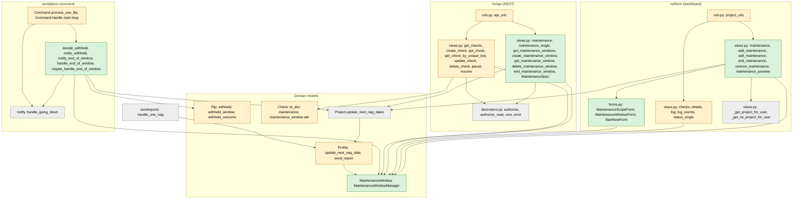

Allowed dependencies are exactly the arrows above. `notify()` (`hc/api/management/commands/sendalerts.py:24-55`), `Flip.select_channels()` (`hc/api/models.py:1390-1408`), `Project.update_next_nag_dates()` (`hc/accounts/models.py:488-499`), the auth decorators and the access helpers are reused without edits.

---

## HTTP Interface

The contract is [`planning/api/openapi.yaml`](api/openapi.yaml), OpenAPI 3.1, `info.x-scope: change`. The repository has no OpenAPI or Swagger document (`.forge/repo-map.json` `api_spec: null`; the REST API is documented by hand in `templates/docs/api.md`), so the file describes the routes this change adds or alters and the existing check routes that share the changed `Check` schema (ADR-010). Every added operation is marked `x-change: added`, every altered one `x-change: changed`.

**Shared error shape.**
- REST API: the one JSON error body produced by `error(msg, status)` (`hc/api/decorators.py:21-22`) and by `JsonResponse({"error": …})` in the views: `{"error": "<message>"}` — `components/schemas/Error`. Used for 400, 401, 403 (window limit) and 409.
- Two existing non-JSON responses are kept, exactly as `pause`/`get_check` use them today: 403 for an object of another project is `HttpResponseForbidden()` with an empty body (`hc/api/views.py:483-484`, `:549-550`), and 404 for an unknown UUID is Django's `Http404` page from `get_object_or_404` (`text/html`). The spec models them as `components/responses/ForbiddenEmpty` and `NotFoundPage`.
- Dashboard: form errors re-render the page with HTTP 200; state errors render `front/maintenance.html` with HTTP 400 and the message in an alert; permission errors are Django's 403 (`PermissionDenied`) and 404 pages. `maintenance_preview` returns the JSON `Error` shape.

**Conventions every operation follows.**
- API routes are mounted under `/api/v1/`, `/api/v2/` and `/api/v3/` with identical behaviour (ADR-005); the spec lists the v3 paths and says so in `info.description`. CORS: `@cors(...)` answers `OPTIONS` with 204 and any unlisted method with 405 (`hc/api/decorators.py:96-120`).
- API auth: `X-Api-Key` header (`components/securitySchemes/ApiKey`); on POST the key may also be `api_key` in the JSON body (`hc/api/decorators.py:49-54`). Writes use `@authorize` (read-write key only), reads `@authorize_read` (either key).
- Dashboard auth: Django session cookie (`components/securitySchemes/Session`) plus the CSRF token on every POST. Anonymous requests to `@login_required` views get 302 to `/accounts/login/?next=…` (`hc/settings.py:278`).
- Times in JSON are ISO 8601, UTC, seconds precision, `+00:00` offset (`isostring`, `hc/api/models.py:112-114`).

| Method | Path | operationId | Role required | Request | Success | Errors |
|---|---|---|---|---|---|---|
| GET | `/api/v3/maintenance/` | `get_maintenance_windows` | read-write or read-only key | query `state` ∈ `active`, `upcoming`, `ended` (optional) | 200 `WindowList` | 400 MW-A16 · 401 |
| POST | `/api/v3/maintenance/` | `create_maintenance_window` | read-write key | JSON `MaintenanceSpec` | 201 `Window` | 400 MW-A01…A14 + existing parse errors · 401 · 403 MW-A15 |
| GET | `/api/v3/maintenance/{uuid}` | `get_maintenance_window` | either key | — | 200 `Window` | 401 · 403 MW-A19 · 404 MW-A20 |
| DELETE | `/api/v3/maintenance/{uuid}` | `delete_maintenance_window` | read-write key | — | 200 `Window` (as before deletion) | 401 · 403 MW-A19 · 404 MW-A20 · 409 MW-A18 |
| POST | `/api/v3/maintenance/{uuid}/end` | `end_maintenance_window` | read-write key | empty, or JSON with only `api_key` | 200 `Window` (`state: "ended"`) | 400 parse errors · 401 · 403 MW-A19 · 404 MW-A20 · 409 MW-A17 |
| GET | `/api/v3/checks/` | `get_checks` (changed) | either key | unchanged | 200, each check gains `maintenance` | unchanged (401) |
| POST | `/api/v3/checks/` | `create_check` (changed) | read-write key | unchanged | 200/201 `Check` + `maintenance` | unchanged |
| GET | `/api/v3/checks/{uuid}` | `get_check` (changed) | either key | — | 200 `Check` + `maintenance` | unchanged |
| GET | `/api/v3/checks/{unique_key}` | `get_check_by_unique_key` (changed) — in the spec as `x-also-served-by` on `get_check`, because OpenAPI forbids two templated paths of the same shape | either key | — | 200 `Check` + `maintenance` | unchanged (404 empty body) |
| POST | `/api/v3/checks/{uuid}` | `update_check` (changed) | read-write key | unchanged | 200 `Check` + `maintenance` | unchanged |
| DELETE | `/api/v3/checks/{uuid}` | `delete_check` (changed) | read-write key | — | 200 `Check` + `maintenance` | unchanged |
| POST | `/api/v3/checks/{uuid}/pause` | `pause` (changed) | read-write key | — | 200 `Check` + `maintenance` | unchanged |
| POST | `/api/v3/checks/{uuid}/resume` | `resume` (changed) | read-write key | — | 200 `Check` + `maintenance` | unchanged (409 plain text) |
| GET | `/projects/{code}/maintenance/` | `maintenance` | any member | — | 200 HTML `front/maintenance.html` | 302 login · 404 |
| POST | `/projects/{code}/maintenance/add/` | `add_maintenance` | writer | form `MaintenanceWindowForm` or `StartNowForm` fields | 302 → `/projects/{code}/maintenance/` | 200 page with form errors · 302 login · 403 · 404 · 405 |
| GET | `/projects/{code}/maintenance/preview/` | `maintenance_preview` | any member | query `scope`, `tags` | 200 `PreviewResult` JSON | 400 MW-D13, MW-D14 · 302 login · 404 |
| POST | `/projects/{code}/maintenance/{mw_code}/edit/` | `edit_maintenance` | writer | form `MaintenanceWindowForm` fields | 302 → Maintenance page | 200 form errors · 400 MW-D10 · 302 login · 403 · 404 · 405 |
| POST | `/projects/{code}/maintenance/{mw_code}/end/` | `end_maintenance` | writer | — (CSRF only) | 302 → Maintenance page | 400 MW-D10, MW-D12 · 302 login · 403 · 404 · 405 |
| POST | `/projects/{code}/maintenance/{mw_code}/remove/` | `remove_maintenance` | writer | — (CSRF only) | 302 → Maintenance page, message "Maintenance window deleted." | 400 MW-D11 · 302 login · 403 · 404 · 405 |
| GET | `/projects/{code}/checks/` | `checks` (changed) | any member | unchanged | 200 HTML, label per covered check | unchanged |
| GET | `/checks/{code}/details/` | `details` (changed) | any member | unchanged | 200 HTML, label, "Start maintenance" for writers | unchanged |
| GET | `/checks/{code}/log/` | `log` (changed) | any member | unchanged | 200 HTML, withheld text on flip rows | unchanged |
| GET | `/checks/{code}/log_events/` | `log_events` (changed) | any member | unchanged | 200 HTML fragment, withheld text | unchanged |
| GET | `/checks/{code}/status/` | `status_single` (changed) | any member | unchanged | 200 JSON, `events` HTML has withheld text | unchanged |

**Contract test that keeps code and spec equal:** `hc/api/tests/test_maintenance_contract.py` (new). It loads `planning/api/openapi.yaml` with PyYAML only if it is importable, and is skipped otherwise (no new dependency, C-4). For each operation marked `x-change` it resolves the path through `django.urls.resolve()` and asserts the view's function name equals the `operationId` (dispatchers `maintenance`, `maintenance_single`, `single`, `checks` are mapped by method). It then calls each API operation with the documented example request and asserts that the status code is one of the documented responses and that the JSON keys equal the schema's `required` + `properties` for `Window`, `WindowList` and `Check`. The always-on part that needs no YAML parser is `test_it_matches_window_json_keys` in `test_get_maintenance.py`, which asserts the exact key set of `MaintenanceWindowDict`.

---

## Internal Interfaces

All new code starts with `from __future__ import annotations` and is fully annotated for `mypy --strict` (NFR-9.1). Exceptions raised are listed per signature; "none" means the function lets only database errors propagate, as the surrounding code does.

### `hc/api/models.py` — module constants (new)

```python
MAINTENANCE_LIMIT = 100                    # upcoming + active windows per project (V10, NFR-6.1)
MAINTENANCE_MAX_LENGTH = td(days=30)       # V7, NFR-6.2
MAINTENANCE_RETENTION = td(days=90)        # REQ-5.11, NFR-8.2
CREATED_VIA = (("dashboard", "Dashboard"), ("api", "API"))
WITHHELD_OUTCOMES = (("released", "Released"), ("superseded", "Superseded"))
```

### `hc/api/models.py` — `MaintenanceWindowDict` (new)

```python
class MaintenanceWindowDict(TypedDict):
    uuid: str
    name: str
    start: str          # isoformat, seconds, +00:00
    end: str
    scope: str          # "all" | "tags"
    tags: str
    state: str          # "upcoming" | "active" | "ended"
    created: str
    created_via: str    # "dashboard" | "api"
```
No creator field exists in this type (REQ-6.14, NFR-8.1).

### `hc/api/models.py` — `MaintenanceWindow` (new, appended after `Flip`)

```python
class MaintenanceWindow(models.Model):
    class Invalid(Exception):
        """A shared rule (V5, V6, V7, V10) failed. `code` selects the message."""
        def __init__(self, code: str) -> None:
            self.code = code     # "end_before_start" | "end_in_past" | "too_long" | "limit"

    # fields: see Data Schema
    objects = MaintenanceWindowManager()

    def __str__(self) -> str                                  # name
    def tags_set(self) -> set[str]                            # set(self.tags.split()); empty for scope "all"
    @property
    def scope(self) -> str                                    # "all" if self.tags == "" else "tags"
    def state(self, at: datetime | None = None) -> str        # "upcoming" if at < start, "active" if start <= at < end, else "ended"; at defaults to now()
    def covers(self, check: Check, at: datetime) -> bool      # BR-1; pure, 0 queries
    def to_dict(self) -> MaintenanceWindowDict                # state evaluated at now(); 0 queries
    @staticmethod
    def normalize_tags(tags: str) -> str                      # BR-12; split on whitespace, dedupe in first-seen order, join with " "
    @staticmethod
    def clean_times(start: datetime, end: datetime, *, at: datetime,
                    move_start: bool = True) -> tuple[datetime, datetime]
        # BR-8..BR-11. Drops microseconds from both. If move_start and start <= at: start = at without microseconds.
        # Then V5 (end > start), V6 (end > at), V7 (end - start <= MAINTENANCE_MAX_LENGTH), in that order.
        # Raises MaintenanceWindow.Invalid("end_before_start" | "end_in_past" | "too_long").
```
The nested exception follows the existing `Ping.GetBodyError` (`hc/api/models.py:703`).

### `hc/api/models.py` — `MaintenanceWindowManager` (new)

Follows `ProfileManager` / `ProjectManager` (`hc/accounts/models.py:61`, `:397`): a plain `models.Manager[...]` subclass with explicit methods.

```python
class MaintenanceWindowManager(models.Manager["MaintenanceWindow"]):
    def flag_checks(self, q: QuerySet[Check], at: datetime) -> QuerySet[Check]:
        """Annotate each check with `maintenance_possible: bool` = EXISTS(a window of the
        check's project with start <= at < end). Adds no query (it is part of q's SELECT)."""

    def set_coverage(self, checks: Sequence[Check], at: datetime) -> None:
        """Set check.maintenance_window on every check: the covering window with the latest
        end (ties: highest id), or None. Checks that carry maintenance_possible=False are
        skipped. 0 queries when no candidate remains, else exactly 1 query. Raises: none."""

    def covering(self, check: Check, at: datetime) -> MaintenanceWindow | None:
        """The window covering `check` at `at` with the latest end, or None. Exactly 1 query.
        Used by sendalerts with at=flip.created (BR-2). Raises: none."""

    def assert_can_add(self, project: Project, at: datetime) -> None:
        """Raise MaintenanceWindow.Invalid("limit") when the project has
        >= MAINTENANCE_LIMIT windows with end > at (BR-10). 1 query (COUNT)."""

    def prune(self, project: Project, at: datetime) -> None:
        """Delete the project's windows with end < at - MAINTENANCE_RETENTION (BR-13).
        1 DELETE query. No table has an FK to MaintenanceWindow, so it is a fast delete."""
```

### `hc/api/models.py` — `Check` (changed)

```python
class Check(models.Model):
    # Used to pass maintenance coverage to views and templates. Not persisted to db.
    maintenance_window: MaintenanceWindow | None = None        # same idiom as past_downtimes (hc/api/models.py:225-226)

    def to_dict(self, *, readonly: bool = False, v: int = 3,
                maintenance: bool | None = None) -> CheckDict:
        """Unchanged, except: when maintenance is not None, result["maintenance"] = maintenance.
        Adds no query."""
```
`CheckDict` (`hc/api/models.py:117-150`) gains `maintenance: NotRequired[bool]`. Callers that pass nothing (the webhook `$JSON`, L-2) get exactly today's dict.

### `hc/api/models.py` — `Flip` (changed)

```python
class Flip(models.Model):
    withheld = models.DateTimeField(null=True, blank=True)
    withheld_window = models.UUIDField(null=True, blank=True)
    withheld_outcome = models.CharField(max_length=10, null=True, blank=True, choices=WITHHELD_OUTCOMES)

    # Set by hc.front.views for event rows. Not persisted to db.
    withheld_window_name: str | None = None

    def is_withheld_unreleased(self) -> bool:
        """withheld is not None and withheld_outcome != "released" (REQ-2.6)."""
```
`to_dict()` and `FlipDict` are unchanged (C-6). `select_channels()` is unchanged.

### `hc/api/management/commands/sendalerts.py` (changed)

```python
END_OF_WINDOW_INTERVAL = td(seconds=15)     # ADR-008, QS-6

@dataclass
class WithholdDecision:
    window_code: uuid.UUID | None   # written to Flip.withheld_window
    supersede: Flip | None          # up flips only: the earlier withheld, unreleased down flip

def notify_withheld(flip: Flip) -> str:
    """Runs in the executor. close_old_connections() exactly like notify() (hc/api/management/commands/sendalerts.py:29-30),
    then flip.owner.project.update_next_nag_dates(). Returns the REQ-2.13 stdout line
    "<check code> goes <new_status> (alert withheld: maintenance window <window code>)".
    Raises: whatever update_next_nag_dates raises (logged by on_notify_done, hc/api/management/commands/sendalerts.py:84-89)."""

def notify_end_of_window(flip: Flip) -> str:
    """Runs in the executor. Calls notify(flip) unchanged. Returns
    "<check code> goes down (end of maintenance)" followed by the per-channel lines of
    notify()'s result (its first line, "<code> goes down", is replaced). If notify() returns
    None (no channels), returns the first line alone (REQ-3.12)."""

class Command(BaseCommand):
    next_end_of_window_pass: datetime | None     # set to None in __init__; first pass runs at startup (REQ-3.5)

    def decide_withhold(self, flip: Flip) -> WithholdDecision | None:
        """BR-2..BR-5. Read-only. down flip: 1 query (MaintenanceWindow.objects.covering).
        up flip with old_status "down": 1 query (the immediately earlier flip of the check,
        ordered by -created, as Flip.down_duration does at hc/api/models.py:1428).
        Any other flip: 0 queries, returns None. Raises: any exception; the caller fails open."""

    def supersede(self, down_flip: Flip) -> bool:
        """BR-6. If down_flip.withheld_outcome is "superseded": return True, 0 queries.
        Else conditional UPDATE withheld_outcome="superseded" WHERE id=… AND withheld_outcome IS NULL.
        rowcount 1 -> True. rowcount 0 -> re-read withheld_outcome: True if "superseded",
        False if "released" or the row is gone. Raises: none beyond database errors."""

    def process_one_flip(self) -> bool:            # CHANGED, same return contract (hc/api/management/commands/sendalerts.py:91-100)
    def handle_end_of_window(self) -> int:         # NEW. Returns the number of released flips. Raises: any (caller logs)
    def maybe_handle_end_of_window(self) -> None:  # NEW. Runs the pass when due, catches and logs every exception
```

### `hc/accounts/models.py` — `Profile` (changed signatures unchanged)

```python
def update_next_nag_date(self) -> None:
    """Same contract as today (hc/accounts/models.py:350-357), but a down check that is
    covered now does not count as down (REQ-4.1). Raises: none."""

def send_report(self, nag: bool = False) -> bool:
    """Unchanged for nag=False. For nag=True the down-check list excludes checks covered now;
    an empty list returns False as today (REQ-4.2, REQ-4.3)."""
```

### `hc/api/views.py` (changed)

```python
class MaintenanceSpec(BaseModel):
    name: str
    start: str | None = None
    end: str | None = None
    duration: int | None = None
    tags: str | None = Field(None, max_length=500)
    # model_validator(mode="before") check_nulls: identical to Spec.check_nulls (hc/api/views.py:84-93)
    # field_validator("name"): strip; "" -> PydanticCustomError("empty"); len > 100 -> PydanticCustomError("too_long")
    # field_validator("start", "end"): datetime.fromisoformat; tzinfo required, else PydanticCustomError("iso8601_tz")
    # field_validator("duration"): 60 <= v <= 2592000, else PydanticCustomError("duration_range")
    def start_dt(self) -> datetime | None        # parsed, converted to UTC
    def end_dt(self) -> datetime | None

CUSTOM_ERRORS additions (hc/api/views.py:144-158; existing keys untouched):
    "missing": "%s is required",
    "empty": "%s must not be empty",
    "iso8601_tz": "%s must be an ISO 8601 date-time with a time zone",
    "duration_range": "%s must be an integer between 60 and 2592000",

MAINTENANCE_ERRORS: dict[str, tuple[str, int]] = {          # MaintenanceWindow.Invalid.code -> (message, status)
    "end_before_start": ("end must be after start", 400),
    "end_in_past": ("end must be in the future", 400),
    "too_long": ("maintenance window can be at most 30 days long", 400),
    "limit": ("too many upcoming or active maintenance windows (limit 100)", 403),
}

@authorize_read
def get_maintenance_windows(request: ApiRequest) -> HttpResponse
@authorize
def create_maintenance_window(request: ApiRequest) -> HttpResponse
@csrf_exempt
@cors("GET", "POST")
def maintenance(request: HttpRequest) -> HttpResponse                     # dispatcher, like checks (:462-468)
@authorize_read
def get_maintenance_window(request: ApiRequest, code: UUID) -> HttpResponse
@authorize
def delete_maintenance_window(request: ApiRequest, code: UUID) -> HttpResponse
@csrf_exempt
@cors("GET", "DELETE")
def maintenance_single(request: HttpRequest, code: UUID) -> HttpResponse  # dispatcher, like single (:532-541)
@cors("POST")
@csrf_exempt
@authorize
def end_maintenance_window(request: ApiRequest, code: UUID) -> HttpResponse   # decorator order of pause (:544-547)
```
The `"missing"` key is reachable only from `MaintenanceSpec` (it is the only model with a required field), so `Spec` messages do not change. Views never raise: every rule failure becomes a response from the Error Catalogue.

Changed check views pass the coverage (see BR-15): `get_checks` uses `flag_checks` + `set_coverage`; `create_check`, `get_check`, `get_check_by_unique_key`, `update_check`, `pause`, `resume` call `set_coverage([check], now())` just before `to_dict(..., maintenance=check.maintenance_window is not None)`; `delete_check` computes it **before** `rename_and_delete()`.

### `hc/api/urls.py` (changed) — appended to `api_urls` (`hc/api/urls.py:48-72`)

```python
path("maintenance/", views.maintenance, name="hc-api-maintenance"),
path("maintenance/<uuid:code>", views.maintenance_single, name="hc-api-maintenance-single"),
path("maintenance/<uuid:code>/end", views.end_maintenance_window, name="hc-api-maintenance-end"),
```
No trailing slash on the single and end routes, matching `checks/<uuid:code>` and `checks/<uuid:code>/pause`.

### `hc/front/forms.py` (changed)

```python
MAINTENANCE_FORM_ERRORS: dict[str, str] = {                 # MaintenanceWindow.Invalid.code -> dashboard message
    "end_before_start": "End must be after start.",
    "end_in_past": "End must be in the future.",
    "too_long": "A maintenance window can be at most 30 days long.",
    "limit": "This project already has 100 upcoming or active maintenance windows. End or delete one before adding another.",
}

class MaintenanceScopeForm(forms.Form):
    name = forms.CharField(max_length=100, error_messages={required, max_length -> "Enter a name of 1 to 100 characters."})
    scope = forms.ChoiceField(choices=(("all", "All checks"), ("tags", "Checks with all of these tags")),
                              error_messages={required, invalid_choice -> "Choose a scope."})
    tags = forms.CharField(max_length=500, required=False,
                           error_messages={max_length -> "Tags can be at most 500 characters."})
    def clean_tags(self) -> str                  # MaintenanceWindow.normalize_tags
    def clean(self) -> dict[str, Any]            # scope "tags" and tags "" -> add_error("tags", "Enter at least one tag."); scope "all" -> tags = ""

class MaintenanceWindowForm(MaintenanceScopeForm):
    start_date = forms.DateField(input_formats=["%Y-%m-%d"])     # errors -> "Enter a valid start date and time."
    start_time = forms.TimeField(input_formats=["%H:%M"])
    end_date = forms.DateField(input_formats=["%Y-%m-%d"])       # errors -> "Enter a valid end date and time."
    end_time = forms.TimeField(input_formats=["%H:%M"])
    def __init__(self, *args: Any, tz: str, **kwargs: Any) -> None
    def clean(self) -> dict[str, Any]
        # BR-14: local date+time in ZoneInfo(tz), fold=0; nonexistent -> V3 error on start_date / end_date.
        # Sets cleaned_data["start"], cleaned_data["end"]: aware UTC datetimes.
    def apply_times(self, at: datetime, *, original_start: datetime | None = None) -> tuple[datetime, datetime] | None
        # Calls MaintenanceWindow.clean_times(start, end, at=at, move_start=original_start is None),
        # with start = original_start when given. On Invalid: add_error("end_date", MAINTENANCE_FORM_ERRORS[code]), return None.

class StartNowForm(MaintenanceScopeForm):
    duration_minutes = forms.IntegerField(min_value=1, max_value=43200)   # errors -> "Enter a length of 1 to 43200 minutes."
```

### `hc/front/views.py` (changed)

```python
def _get_maintenance_window(project: Project, mw_code: UUID) -> MaintenanceWindow
    # get_object_or_404(MaintenanceWindow, project=project, code=mw_code)  -> Http404 for another project's window (REQ-1.17)

def _maintenance_ctx(request: AuthenticatedHttpRequest, project: Project, rw: bool) -> dict[str, Any]
    # page="maintenance", project, rw, tz=request.profile.tz, active / upcoming / ended lists, all_tags, empty forms

def _set_withheld_window_names(check: Check, events: Sequence[object]) -> None
    # BR-17. 0 queries when no event is a withheld Flip, else 1 query:
    # MaintenanceWindow.objects.filter(project_id=check.project_id, code__in=codes).values_list("code", "name")

@login_required
def maintenance(request: AuthenticatedHttpRequest, code: UUID) -> HttpResponse
@require_POST
@login_required
def add_maintenance(request: AuthenticatedHttpRequest, code: UUID) -> HttpResponse
@require_POST
@login_required
def edit_maintenance(request: AuthenticatedHttpRequest, code: UUID, mw_code: UUID) -> HttpResponse
@require_POST
@login_required
def end_maintenance(request: AuthenticatedHttpRequest, code: UUID, mw_code: UUID) -> HttpResponse
@require_POST
@login_required
def remove_maintenance(request: AuthenticatedHttpRequest, code: UUID, mw_code: UUID) -> HttpResponse
@login_required
def maintenance_preview(request: AuthenticatedHttpRequest, code: UUID) -> HttpResponse
```
Errors: `Http404` (non-member, unknown or foreign window) and `PermissionDenied` (read-only member on a write) raised by the existing helpers; everything else is a response. The decorator order `@require_POST` then `@login_required` is the one `add_check` uses (`hc/front/views.py:529-531`). The six views are placed after `badges` (`hc/front/views.py:1154-1201`).

### `hc/front/urls.py` (changed) — appended to `project_urls` (`hc/front/urls.py:42-48`)

```python
path("maintenance/", views.maintenance, name="hc-maintenance"),
path("maintenance/add/", views.add_maintenance, name="hc-add-maintenance"),
path("maintenance/preview/", views.maintenance_preview, name="hc-maintenance-preview"),
path("maintenance/<uuid:mw_code>/edit/", views.edit_maintenance, name="hc-edit-maintenance"),
path("maintenance/<uuid:mw_code>/end/", views.end_maintenance, name="hc-end-maintenance"),
path("maintenance/<uuid:mw_code>/remove/", views.remove_maintenance, name="hc-remove-maintenance"),
```
`preview/` and `add/` are literal segments; `<uuid:mw_code>` cannot match them, so order does not matter.

### Templates and static (new contracts)

| File | Context it needs | Contract |
|---|---|---|
| `front/maintenance.html` | `_maintenance_ctx` + optional `form`, `start_now_form`, `open_modal` (`"add"`, `"start-now"` or `"edit-<uuid>"`), `error_message` | Sections `#maintenance-active`, `#maintenance-upcoming`, `#maintenance-ended`; empty state "No maintenance windows yet."; writer controls only when `rw` |
| `front/maintenance_label.html` | `mw` (a `MaintenanceWindow`), `tz` | `<span class="label label-maintenance" title="…" aria-label="…"><span class="ic-maintenance" aria-hidden="true"></span> Maintenance</span>`; title and aria-label are `Under maintenance until {{ mw.end\|timezone:tz\|date:"M j, H:i" }} {{ tz }} ({{ mw.name }})` |
| `front/log_row.html` flip branch | `event.withheld`, `event.withheld_window_name` | After the status line: `<span class="withheld">Alert not sent: maintenance window "<name>"</span>`, or without the quoted name when the name is None |
| `static/js/maintenance.js` | `data-preview-url` on the form | Debounced (300 ms) `GET preview/?scope=&tags=`; writes the result with `.text()` only, never `.html()` (REQ-5.9); presets 30/60/120/240 fill `duration_minutes`; disables submit after the first click (REQ-1.19); reopens the modal named by `data-open-modal` |

---

## Data Schema

### Model definitions

```python
class MaintenanceWindow(models.Model):
    code = models.UUIDField(default=uuid.uuid4, editable=False, unique=True)
    project = models.ForeignKey(Project, models.CASCADE)
    name = models.CharField(max_length=100)
    start = models.DateTimeField()
    end = models.DateTimeField()
    tags = models.CharField(max_length=500, blank=True)
    created = models.DateTimeField(default=now)
    created_by = models.ForeignKey(User, models.SET_NULL, null=True, blank=True)
    created_via = models.CharField(max_length=9, choices=CREATED_VIA)
    # Internal: when the end-of-window pass recomputed nag dates for this window's end (ADR-008).
    end_handled = models.DateTimeField(null=True, blank=True, editable=False)

    class Meta:
        indexes = (
            # Windows of one project that have not ended; pruning. Used by every coverage query.
            models.Index(fields=["project", "end"], name="api_mw_project_end"),
            # Ended windows whose end the sendalerts pass has not handled yet.
            models.Index(
                fields=["end"],
                name="api_mw_end_not_handled",
                condition=models.Q(end_handled=None),
            ),
        )


class Flip(models.Model):          # existing fields unchanged
    ...
    withheld = models.DateTimeField(null=True, blank=True)
    withheld_window = models.UUIDField(null=True, blank=True)
    withheld_outcome = models.CharField(
        max_length=10, null=True, blank=True, choices=WITHHELD_OUTCOMES
    )

    class Meta:
        indexes = (
            ...,  # api_flip_not_processed, api_flip_owner_created unchanged
            # For quickly finding withheld down flips that wait for release.
            # Used in the sendalerts end-of-window pass.
            models.Index(
                fields=["withheld"],
                name="api_flip_withheld_pending",
                condition=models.Q(withheld__isnull=False, withheld_outcome=None),
            ),
        )
```

Notes on the definitions:
- `start` and `end` are reserved words in SQL. Django quotes every column name on all four engines, and the repo uses no raw SQL (NFR-3.2), so the PRD field names are kept.
- `created_by` uses the default reverse name `maintenancewindow_set` on `User`. `Project` gets `maintenancewindow_set` too.
- `withheld` holds the claim instant (the same value written to `processed`). `withheld_window` is a UUID with **no FK** (ADR-006). `withheld_outcome` is NULL while a down flip is pending, `"released"` after the pass sent its alert, `"superseded"` when it was closed without an alert. Withheld **up** flips are stored as `"superseded"` in their own claim, so the pending set holds down flips only.
- No FK points at `Flip`, so `Check.prune()` keeps deleting flips with a single DELETE (`hc/api/models.py:603`, RK-4).

### Equivalent DDL (PostgreSQL, from the definitions above; `sqlmigrate` output is authoritative)

```sql
CREATE TABLE "api_maintenancewindow" (
    "id" integer NOT NULL PRIMARY KEY GENERATED BY DEFAULT AS IDENTITY,
    "code" uuid NOT NULL UNIQUE,
    "name" varchar(100) NOT NULL,
    "start" timestamp with time zone NOT NULL,
    "end" timestamp with time zone NOT NULL,
    "tags" varchar(500) NOT NULL,
    "created" timestamp with time zone NOT NULL,
    "created_via" varchar(9) NOT NULL,
    "end_handled" timestamp with time zone NULL,
    "created_by_id" integer NULL REFERENCES "auth_user" ("id") DEFERRABLE INITIALLY DEFERRED,
    "project_id" integer NOT NULL REFERENCES "accounts_project" ("id") DEFERRABLE INITIALLY DEFERRED
);
CREATE INDEX "api_mw_project_end" ON "api_maintenancewindow" ("project_id", "end");
CREATE INDEX "api_mw_end_not_handled" ON "api_maintenancewindow" ("end") WHERE "end_handled" IS NULL;
-- plus Django's automatic indexes on created_by_id and project_id

ALTER TABLE "api_flip" ADD COLUMN "withheld" timestamp with time zone NULL;
ALTER TABLE "api_flip" ADD COLUMN "withheld_window" uuid NULL;
ALTER TABLE "api_flip" ADD COLUMN "withheld_outcome" varchar(10) NULL;

CREATE INDEX "api_flip_withheld_pending" ON "api_flip" ("withheld")
    WHERE ("withheld" IS NOT NULL AND "withheld_outcome" IS NULL);
```
`ON DELETE CASCADE` / `SET NULL` are applied by Django's collector, as for every FK in this repo.

### ER diagram of the delta

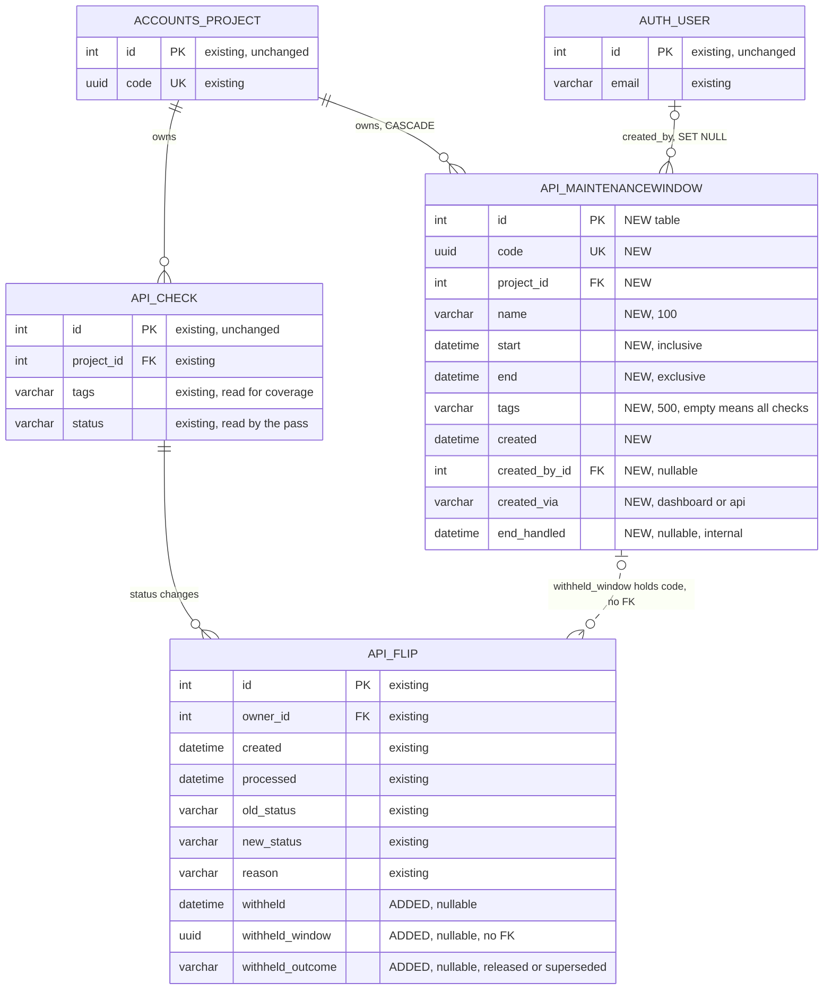

### Migrations (expand only; app `api`)

| # | File | Operations | Depends on | Reverse | Lock / volume |
|---|---|---|---|---|---|
| 1 | `0124_maintenancewindow.py` | `CreateModel("MaintenanceWindow", …)` with both indexes in `options["indexes"]` | `("api", "0123_alter_channel_kind")`, `("accounts", "0053_alter_profile_sms_limit")`, `migrations.swappable_dependency(settings.AUTH_USER_MODEL)` | Drops the table | New empty table |
| 2 | `0125_flip_withheld.py` | 3 × `AddField("flip", …)`, all `null=True`, no default | `("api", "0124_maintenancewindow")` | `RemoveField` × 3 | `ADD COLUMN … NULL` with no default: metadata-only on PostgreSQL ≥11 and MySQL 8 / MariaDB (INSTANT). On SQLite Django uses `ALTER TABLE ADD COLUMN` for a nullable column with no default and no FK — the reason ADR-006 has no FK. Confirm with `sqlmigrate api 0125` on SQLite (AH-3) before merge |
| 3 | `0126_flip_api_flip_withheld_pending.py` | `AddIndex("flip", Index(…, condition=…))` | `("api", "0125_flip_withheld")` | `RemoveIndex` | One scan of `api_flip` on PostgreSQL with a write lock (RK-10, named in the CHANGELOG line). Django skips conditional indexes on MySQL/MariaDB (AH-2) |

Each step is reversible with `manage.py migrate api 0123` (or the step before). There is no data migration: every existing flip reads as "not withheld" because all three columns are NULL. There is no contract step in this release; if the feature is ever removed, dropping the table and the three columns is a later release after the code stops reading them. `makemigrations --check --dry-run` must print "No changes detected" (REQ-7.2, NFR-9.2). The migration files are hand-checked to use the index names above so that they match `Meta.indexes`.

---

## Domain Model

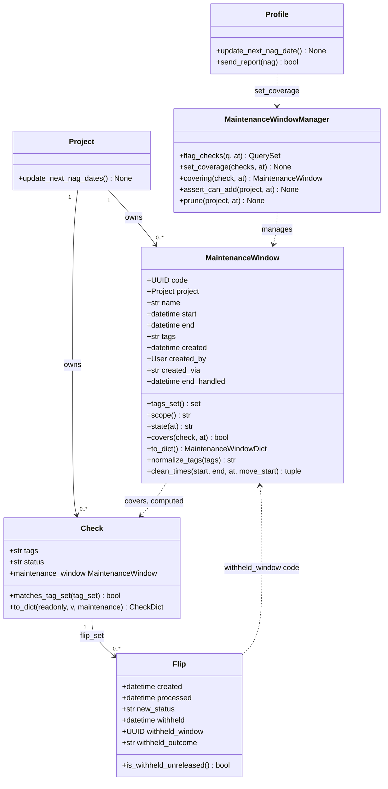

`MaintenanceWindow` and `MaintenanceWindowManager` are new; `Check`, `Flip` and `Profile` are changed (attributes and methods listed above are the changed or used ones); `Project` is unchanged.

### Business rules

| ID | Rule | Implements |
|---|---|---|
| BR-1 | **Coverage predicate.** `W.covers(C, t)` ⇔ `C.project_id == W.project_id` and `W.start <= t < W.end` and (`W.tags == ""` or `C.matches_tag_set(W.tags_set())`). Tag matching is exact and case-sensitive. The project and tags are the check's values when evaluated. This is the only implementation; the manager methods filter by project and interval in SQL and call `covers` semantics in Python for tags | REQ-2.2, REQ-2.3, REQ-2.4, AS-3, AS-4 |
| BR-2 | **Down-flip decision.** A down flip F is withheld iff `MaintenanceWindow.objects.covering(F.owner, F.created)` returns a window W. Its mark references W; when several windows cover, W is the one with the latest `end` (ties: highest id). Evaluated at `F.created`, never at now | REQ-2.1, REQ-2.7, REQ-2.11, NFR-2.1 |
| BR-3 | **Up-flip decision.** An up flip U with `old_status == "down"` is withheld iff the immediately earlier flip of the same check (`created < U.created`, latest first) is a down flip D with `D.is_withheld_unreleased()`. Coverage at `U.created` is not consulted. U's mark copies `D.withheld_window` | REQ-2.5, REQ-2.6, REQ-3.10 |
| BR-4 | Any other flip (an up flip from `new` or `paused`, or any flip whose earlier down flip was delivered or released) is delivered exactly as today; `select_channels` exclusions still apply | REQ-2.10 |
| BR-5 | **Fail open.** Any exception raised by `decide_withhold` or `supersede` is logged with `logger.exception` and the flip is delivered | NFR-2.3, DECISION-14 |
| BR-6 | **Settle before claim (L-3).** For a withheld up flip, D is settled as `"superseded"` with a conditional UPDATE before U is claimed. If D turns out to be `"released"` (lost race with the pass) or gone, U is delivered instead | REQ-2.6, REQ-3.6, NFR-2.2 |
| BR-7 | **Release.** At each end-of-window pass a pending down flip F (withheld, outcome NULL) of check C is: left pending if C is covered now; settled `"superseded"` if a later flip of C exists or `C.status != "down"` (paused included); otherwise claimed `"released"` with `UPDATE … WHERE withheld_outcome IS NULL` and, on rowcount 1 only, sent through the unchanged `notify()`. Deleted checks lose their flips by CASCADE and are never sent | REQ-3.1–3.9, REQ-3.11, DECISION-6 |
| BR-8 | **Start in the past.** At create, and at edit of an upcoming window, a start `<= now` becomes `now` without microseconds | REQ-1.3, REQ-6.4, DECISION-1 |
| BR-9 | **Seconds precision.** Stored `start` and `end` have microsecond 0. End now stores `now()` without microseconds | REQ-6.4, REQ-1.11 |
| BR-10 | **Window rules shared by both paths** (`MaintenanceWindow.clean_times`, `assert_can_add`): V5 `end > start`, V6 `end > now`, V7 `end − start <= 30 days` (on edit of an active window, with the stored start), V10 `< 100` windows with `end > now` at create. Checked in this order, after field validation | REQ-1.4, REQ-1.5, REQ-6.5, REQ-6.6, NFR-6.1, NFR-6.2 |
| BR-11 | **API duration.** `end = start + duration`, where `start` is the start after BR-8. Exactly one of `end` and `duration` is required | REQ-6.3, DECISION-12 |
| BR-12 | **Tag normalisation.** Split on whitespace, drop duplicates keeping the first occurrence, join with single spaces. `""` means all checks. The dashboard scope `all` stores `""` whatever the tags field held | V8, V9 |
| BR-13 | **Retention.** A project's windows with `end < now − 90 days` are deleted (one DELETE) when its Maintenance page is requested, when `GET maintenance/` is called, and when a window create passes field validation (dashboard or API). Marks referencing them keep the code, which then resolves to no name | REQ-5.11, REQ-5.2, NFR-8.2, ADR-004 |
| BR-14 | **Local time.** Dashboard date+time are read in the viewer's `Profile.tz`. An ambiguous time uses `fold=0`. A time that does not round-trip (`aware.astimezone(UTC).astimezone(tz)` differs in wall-clock value) is nonexistent and rejected | REQ-1.18, DECISION-3, REQ-5.10 |
| BR-15 | **Check JSON key.** API responses that contain check JSON carry `"maintenance": true` iff the check is covered now (BR-1 at `now()`). Lists compute it with one EXISTS annotation plus at most one window query; single-check responses with one window query; `delete_check` computes it before deletion | REQ-6.15, NFR-1.1, ADR-009 |
| BR-16 | **Label.** A check shows the label iff covered now; the title names the covering window with the latest end. An upcoming window never produces a label. Computed at page load only | REQ-5.3, DECISION-7 |
| BR-17 | **Withheld text.** A flip row with `withheld` set shows `Alert not sent: maintenance window "<name>"`; the name is resolved only among windows of the check's current project (L-6); otherwise the text has no name | REQ-5.1, REQ-5.2 |
| BR-18 | **Editing.** Upcoming: name, start, end, scope may change. Active: name and end only; a change of start (compared at minute precision, the form's precision) or of normalised scope/tags is rejected. Ended: nothing may change | REQ-1.8, REQ-1.9, REQ-1.10, REQ-1.14, DECISION-2 |
| BR-19 | **End now** is allowed only for an active window; **Delete** only for an upcoming one | REQ-1.11, REQ-1.12, REQ-1.13, REQ-6.8–6.11 |
| BR-20 | **Nag recompute after writes.** Every successful create, edit, end or delete (dashboard or API) calls `project.update_next_nag_dates()` before responding | REQ-1.20 |
| BR-21 | **Nags skip covered checks.** `update_next_nag_date` treats a down check that is covered now as not down; `send_report(nag=True)` leaves covered checks out of the list and out of `num_down` | REQ-4.1, REQ-4.2, REQ-4.3, REQ-4.5 |
| BR-22 | **Nag recompute at window end.** The pass claims each ended window once (`end_handled` conditional UPDATE) and calls `project.update_next_nag_dates()` for its project | REQ-4.4 |
| BR-23 | **Creator.** `created_by` = request user and `created_via = "dashboard"` on the dashboard; `created_by = None` and `created_via = "api"` on the API. No creator data in JSON | REQ-1.2, REQ-6.3, REQ-6.14, REQ-5.5, DECISION-10 |
| BR-24 | **No uniqueness.** Identical windows may coexist | REQ-1.19, DECISION-4 |

---

## State Machines

### Maintenance window (new lifecycle; the state is derived from `start`, `end` and now, never stored)

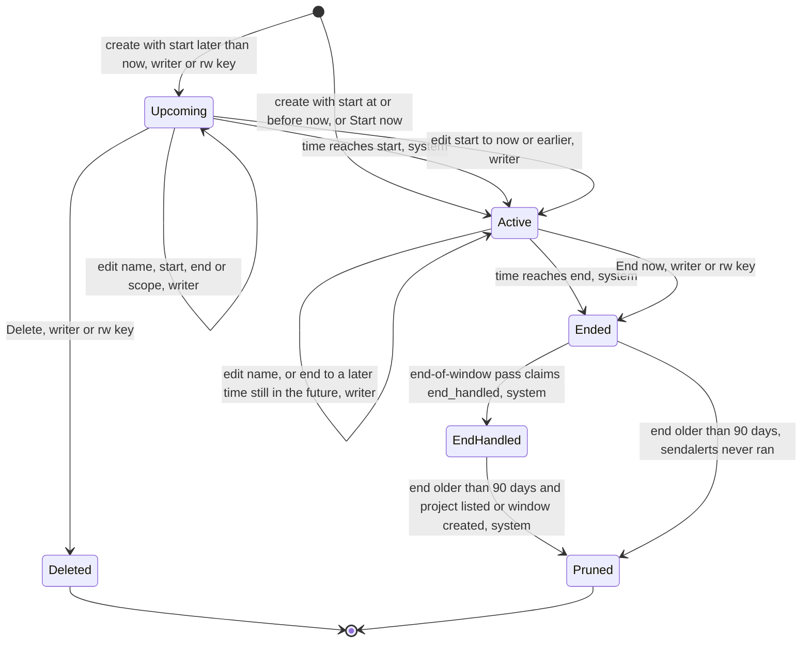

| Transition | Who | Refused when (response) |
|---|---|---|
| create | writer (`add_maintenance`), read-write key (`create_maintenance_window`) | invalid fields (200 form / 400 JSON); V10 limit (200 form / 403 JSON); read-only member 403; read-only key 401 |
| edit | writer only | active + start or scope changed (200 form, MW-D09); ended (400, MW-D10) |
| End now | writer, read-write key | upcoming (400 MW-D12 / 409 MW-A17); ended (400 MW-D10 / 409 MW-A17) |
| Delete | writer, read-write key | active or ended (400 MW-D11 / 409 MW-A18) |
| Ended → Active | nobody | not reachable: edits of ended windows are refused, and a new end must be in the future (V6) |
| `end_handled` claim | `sendalerts` only | already claimed by another process (rowcount 0, skipped) |

### Withheld mark of a flip (new lifecycle on an existing row)

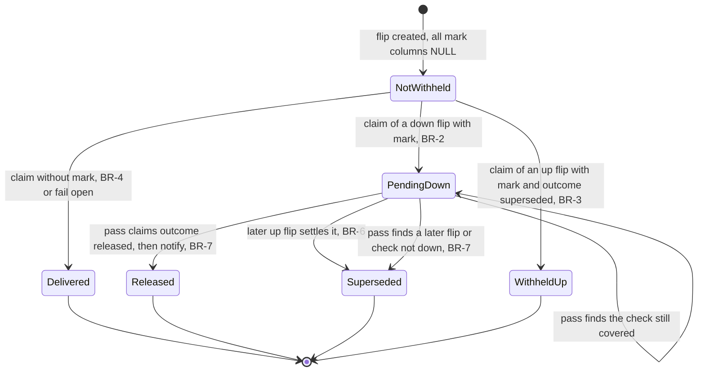

| State | `processed` | `withheld` | `withheld_window` | `withheld_outcome` |
|---|---|---|---|---|
| NotWithheld | NULL | NULL | NULL | NULL |
| Delivered (today's only path) | set | NULL | NULL | NULL |
| PendingDown | set | set | window code | NULL |
| Released | set | set | window code | `released` |
| Superseded | set | set | window code | `superseded` |
| WithheldUp | set | set | earlier down flip's window code | `superseded` |

Every transition out of NotWithheld is the existing conditional claim on `processed IS NULL`; every transition out of PendingDown is a conditional UPDATE on `withheld_outcome IS NULL`. A row in Released, Superseded or WithheldUp is never written again. The existing `Check` status machine is untouched.

---

## Detailed Flows

### F-1 `process_one_flip` with the withhold decision (changed critical flow)

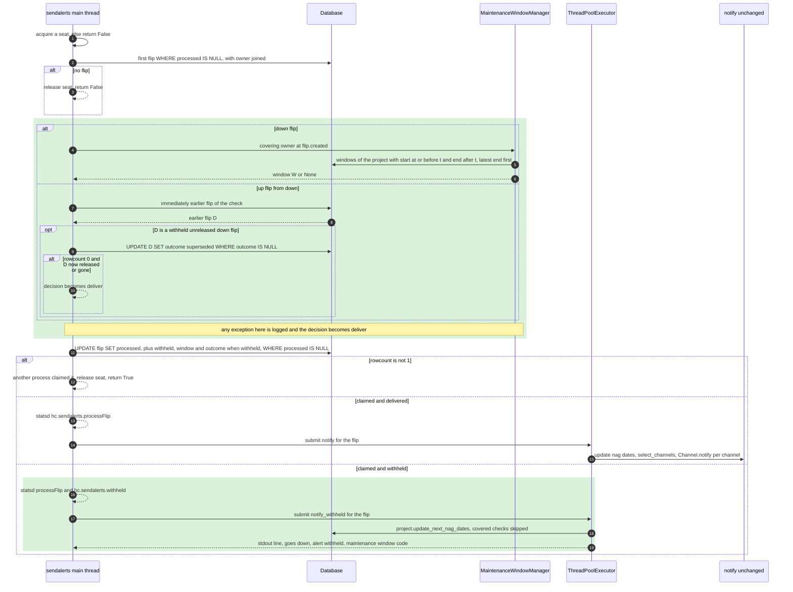

Edge and failure paths:
- **0 windows** (G4): a down flip costs the covering query (finds nothing); the owner join removes `notify()`'s lazy owner load, so the total query count equals today's. No new statsd call and no new stdout line on the deliver path; `hc/api/tests/test_sendalerts.py:78` (`statsd.incr.assert_called_once()`) keeps passing.
- **Down flip already claimed by another process**: the decision read is wasted; nothing else happens (ADR-007).
- **Up flip, two processes**: both may read D pending; one settles it (rowcount 1), the other gets rowcount 0, re-reads `"superseded"` and also decides "withhold"; only one claims U. Both choices agree.
- **Up flip vs the end-of-window pass**: exactly one of "pass releases D" and "U settles D" wins the `withheld_outcome IS NULL` update. Pass wins → down alert sent, U delivered (up alert follows). U wins → no alert for either.
- **Window ended early after the flip** (REQ-2.11): the decision uses `flip.created`; End now set `end` to an instant after `flip.created`, so W still covers it.
- **Flip with status other than up or down** (not produced today; `create_flip` marks paused/new flips processed): the decision returns None and today's path runs, including `select_channels`' `NotImplementedError`.

### F-2 End-of-window pass (new critical flow)

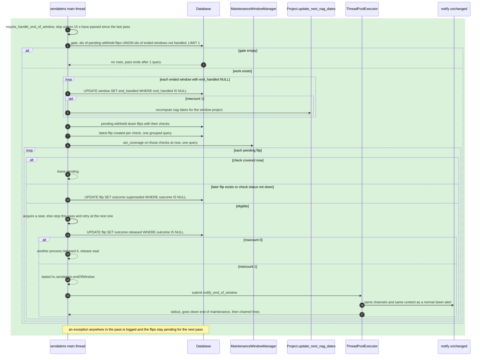

Edge and failure paths:
- **Idle** (QS-6, REQ-3.13): exactly the gate query, at most once per 15 s ⇒ ≤0.07 queries/s.
- **Restart after downtime** (REQ-3.5): `next_end_of_window_pass` is None at startup, so the first loop iteration runs the pass.
- **Overlapping windows** (REQ-3.3): at 11:00 W2 still covers C → left pending; at 12:00 released.
- **Tag removed / check transferred / End now / end shortened** (REQ-3.4, REQ-3.7): all reduce to "not covered now" at the next pass.
- **End extended before it is reached** (REQ-3.8): still covered at the old end → left pending.
- **Paused** (REQ-3.9): `status == "paused"` ⇒ superseded, nothing sent. **Deleted check**: its flips are gone (CASCADE), nothing to do.
- **Crash between the release claim and `notify`**: that one alert is lost; a second process can never send it twice (NFR-2.2, same guarantee as `processed`).
- **Busy main loop** (L-5): `maybe_handle_end_of_window` is also called inside the `process_one_flip` loop, so the 15 s interval holds while flips keep arriving.

Main loop after the change (`hc/api/management/commands/sendalerts.py:201-213`):

```python
while not self.shutdown:
    while self.handle_going_down() and not self.shutdown:
        pass
    while self.process_one_flip() and not self.shutdown:
        self.maybe_handle_end_of_window()
    self.maybe_handle_end_of_window()
    if not self.shutdown:
        time.sleep(2)
```

### F-3 API create (new flow)

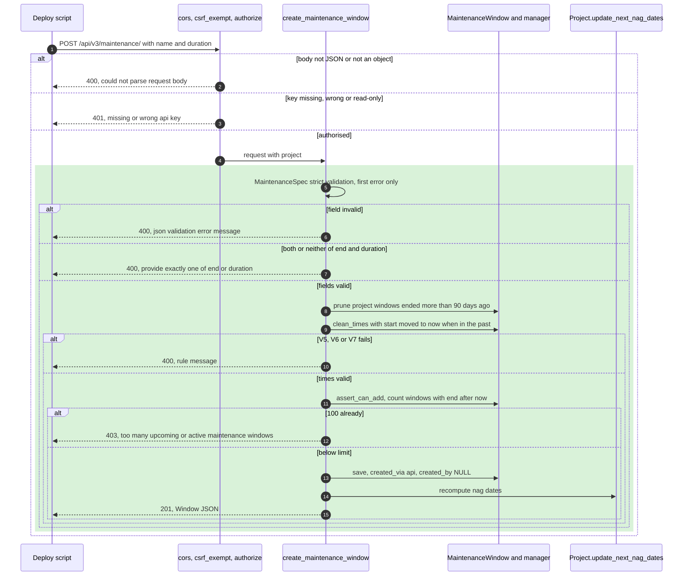

`get_maintenance_windows` (REQ-6.1, REQ-6.2): validate `state` first (400 MW-A16), prune, then `filter(project=request.project)`, narrowed by `start__gt=now` (upcoming), `start__lte=now, end__gt=now` (active) or `end__lte=now` (ended), ordered by `-start`, `-id`.

### F-4 API end and delete (new flow)

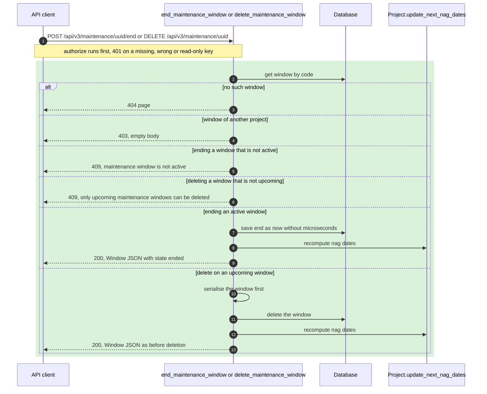

The release for checks covered by an ended window happens in F-2 within 60 s (REQ-3.4). The API view does not send alerts itself.

### F-5 Dashboard edit (new flow)

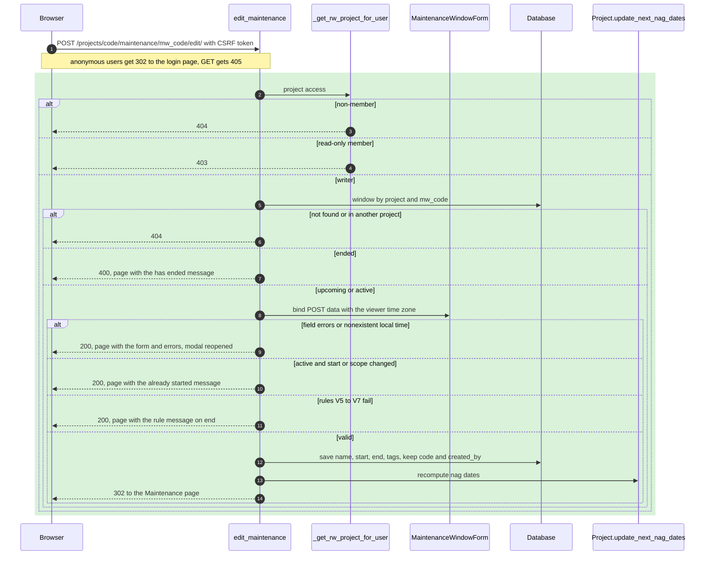

`add_maintenance` is the same flow without the window lookup: it chooses `StartNowForm` when `duration_minutes` is in the POST data and `MaintenanceWindowForm` otherwise, prunes (BR-13), applies `apply_times` (BR-8, BR-10) and `assert_can_add`, and saves with `created_by=request.user`, `created_via="dashboard"`. `end_maintenance` and `remove_maintenance` follow F-4's state checks with the dashboard responses (400 page, 302 with `messages.success(request, "Maintenance window deleted.")` for remove).

### F-6 Nag date recompute with coverage (changed flow)

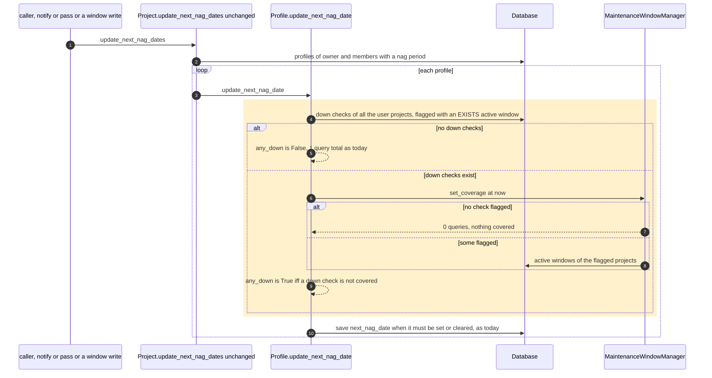

`send_report(nag=True)` applies the same `set_coverage` to its already-loaded down list (≤1 query, only when down checks exist) and filters out covered checks before building `ctx["checks"]` and `ctx["num_down"]`. The empty-list path returns False, and `handle_one_nag` then clears `next_nag_date` as it does today (`hc/api/management/commands/sendreports.py:85-91`).

---

## Error Catalogue

Codes are new identifiers for this change, used in tests and stories. "Message" is the exact string. API messages go in `{"error": …}` unless the status says otherwise. No log is written for client errors, the same as every existing API and dashboard validation error.

### REST API

| Code | Meaning | HTTP status | User message | Log level |
|---|---|---|---|---|
| (existing) | Body not JSON | 400 | `could not parse request body` | none |
| (existing) | JSON body not an object | 400 | `json validation error: value is not an object` | none |
| (existing) | Key absent or not 32 characters | 401 | `missing api key` | none |
| (existing) | Key matches no project, or read-only key on a write | 401 | `wrong api key` | none |
| MW-A01 | `name` absent | 400 | `json validation error: name is required` | none |
| MW-A02 | `name` longer than 100 after trimming | 400 | `json validation error: name is too long` | none |
| MW-A03 | `name` empty after trimming | 400 | `json validation error: name must not be empty` | none |
| MW-A04 | `name`, `start`, `end` or `tags` not a string (null included) | 400 | `json validation error: <field> is not a string` | none |
| MW-A05 | `start` not ISO 8601 with offset | 400 | `json validation error: start must be an ISO 8601 date-time with a time zone` | none |
| MW-A06 | `end` not ISO 8601 with offset | 400 | `json validation error: end must be an ISO 8601 date-time with a time zone` | none |
| MW-A07 | Both or neither of `end` and `duration` | 400 | `json validation error: provide exactly one of end or duration` | none |
| MW-A08 | `duration` outside 60…2 592 000 | 400 | `json validation error: duration must be an integer between 60 and 2592000` | none |
| MW-A09 | `duration` not an integer (`"3600"`, `1.5`, `true`, null) | 400 | `json validation error: duration is not a number` | none |
| MW-A10 | `tags` longer than 500 | 400 | `json validation error: tags is too long` | none |
| MW-A12 | V5 | 400 | `end must be after start` | none |
| MW-A13 | V6 | 400 | `end must be in the future` | none |
| MW-A14 | V7 | 400 | `maintenance window can be at most 30 days long` | none |
| MW-A15 | V10 limit | 403 | `too many upcoming or active maintenance windows (limit 100)` | none |
| MW-A16 | `state` query value not allowed | 400 | `invalid state, expected active, upcoming or ended` | none |
| MW-A17 | End on an upcoming or ended window | 409 | `maintenance window is not active` | none |
| MW-A18 | Delete of an active or ended window | 409 | `only upcoming maintenance windows can be deleted` | none |
| MW-A19 | Window of another project | 403 | empty body (`HttpResponseForbidden`) | none |
| MW-A20 | No window with that UUID | 404 | Django "Not Found" page (`get_object_or_404`) | none (Django's own `django.request` WARNING) |
| (existing) | Method not allowed | 405 | empty body | none |

MW-A11 is not used (V11's other types are covered by MW-A04 and MW-A09).

### Dashboard

| Code | Meaning | HTTP status | User message | Log level |
|---|---|---|---|---|
| MW-D01 | V1 name | 200 (form re-rendered) | Enter a name of 1 to 100 characters. | none |
| MW-D02 | V2 start date/time | 200 | Enter a valid start date and time. | none |
| MW-D03 | V3 nonexistent local time (start or end) | 200 | `<YYYY-MM-DD HH:MM> does not exist in <tz> because of a daylight-saving change. Choose another time.` | none |
| MW-D04 | V4 end date/time | 200 | Enter a valid end date and time. | none |
| MW-D05 | V5 / V6 / V7 | 200 | End must be after start. / End must be in the future. / A maintenance window can be at most 30 days long. | none |
| MW-D06 | V8 scope | 200 | Choose a scope. | none |
| MW-D07 | V9 tags | 200 | Enter at least one tag. / Tags can be at most 500 characters. | none |
| MW-D08 | V10 limit | 200 | This project already has 100 upcoming or active maintenance windows. End or delete one before adding another. | none |
| MW-D09 | Start or scope changed on an active window | 200 | This window has already started. Only its name and end time can be changed. | none |
| MW-D10 | Edit or End now on an ended window | 400 | This maintenance window has ended and can no longer be changed. | none |
| MW-D11 | Delete of an active or ended window | 400 | Only upcoming maintenance windows can be deleted. Use End now to stop an active window. | none |
| MW-D12 | End now on an upcoming window | 400 | This maintenance window has not started yet. Delete it instead. | none |
| MW-D13 | Preview `tags` longer than 500 | 400 JSON | `{"error": "tags is too long"}` | none |
| MW-D14 | Preview `scope` present and not `all`/`tags` | 400 JSON | `{"error": "invalid scope"}` | none |
| MW-D15 | Start-now length outside 1…43 200 or not an integer | 200 | Enter a length of 1 to 43200 minutes. | none |
| (existing) | Non-member, unknown or foreign window | 404 | Django 404 page | none |
| (existing) | Read-only member on a write | 403 | Django 403 page | none |
| (existing) | Anonymous | 302 | redirect to `/accounts/login/?next=…` | none |
| (existing) | GET on a POST-only view | 405 | empty | none |

### Worker (`sendalerts`)

| Code | Meaning | HTTP status | User message | Log level |
|---|---|---|---|---|
| MW-W01 | Exception in `decide_withhold` or `supersede` | — | none; the flip is delivered | ERROR via `logger.exception("Exception while deciding whether to withhold flip %d", flip.id)`, logger `"hc"` → persisted by `hc.logs.Handler` |
| MW-W02 | Exception in `handle_end_of_window` | — | none; pending flips stay pending | ERROR via `logger.exception("Exception in end-of-window pass")` |
| (existing) | Exception in `notify_withheld` / `notify_end_of_window` | — | none | ERROR via `on_notify_done` (`hc/api/management/commands/sendalerts.py:84-89`), unchanged |

---

## Validation Rules

Order: the rows are checked top to bottom and only the first failure is reported (PRD *Validation and errors*). "now" is `django.utils.timezone.now()` at validation time.

### API — `POST /api/vN/maintenance/` (`MaintenanceSpec`, `model_validate(strict=True)`)

| Field | Type | Required | Format / limits | Rejection |
|---|---|---|---|---|
| (body) | JSON object or empty | yes for create | parsed by `@authorize` | existing parse messages |
| `name` | string | yes | trimmed; 1–100 characters | MW-A01, MW-A03, MW-A02, MW-A04 |
| `start` | string | no (absent ⇒ now) | `datetime.fromisoformat`, `tzinfo` required (`Z` accepted); converted to UTC; microseconds dropped | MW-A05, MW-A04 |
| `end` | string | one of `end`/`duration` | as `start` | MW-A06, MW-A04, MW-A07 |
| `duration` | integer (strict, not bool, not string) | one of `end`/`duration` | 60 ≤ n ≤ 2 592 000 seconds | MW-A09, MW-A08, MW-A07 |
| `tags` | string | no (absent or `""` ⇒ all checks) | ≤500 characters; normalised (BR-12) | MW-A10, MW-A04 |
| `api_key` and any other key | any | no | ignored by the model (Pydantic default `extra="ignore"`), as `Spec` does | — |
| (window) | — | — | BR-8, then V5, V6, V7, then V10 | MW-A12, MW-A13, MW-A14, MW-A15 |

Null values: the `check_nulls` before-validator turns `null` into `0.0`, so every field rejects it with its type message (same behaviour as `Spec`).

### API — query and path

| Input | Type | Rule | Rejection |
|---|---|---|---|
| `state` (GET list) | string | absent, or one of `active`, `upcoming`, `ended` | MW-A16 |
| `{uuid}` | path | Django `uuid` converter; anything else does not match the route | 404 (URL resolver) |
| `POST …/end` body | empty or JSON object | only `api_key` is read | existing parse messages |

### Dashboard — `MaintenanceWindowForm` (schedule and edit)

| Field | Type | Required | Format / limits | Rejection |
|---|---|---|---|---|
| `name` | text | yes | Django `strip=True`; 1–100 characters | MW-D01 |
| `start_date` | date | yes | `YYYY-MM-DD` | MW-D02 |
| `start_time` | time | yes | `HH:MM`, 24 h | MW-D02 |
| `end_date` | date | yes | `YYYY-MM-DD` | MW-D04 |
| `end_time` | time | yes | `HH:MM` | MW-D04 |
| (start, end) | — | — | local time in `Profile.tz`, fold=0, nonexistent rejected (BR-14) | MW-D03 |
| `scope` | choice | yes | `all` or `tags` | MW-D06 |
| `tags` | text | when scope = `tags` | ≤500 characters, ≥1 token, normalised | MW-D07 |
| (window) | — | — | create/upcoming edit: BR-8 then V5–V7; active edit: stored start, V5–V7, plus BR-18; create: V10 | MW-D05, MW-D09, MW-D08 |

### Dashboard — `StartNowForm`

| Field | Type | Required | Format / limits | Rejection |
|---|---|---|---|---|
| `name`, `scope`, `tags` | as above | as above | as above | MW-D01, MW-D06, MW-D07 |
| `duration_minutes` | integer | yes | 1–43 200 | MW-D15 |
| (window) | — | — | start = now (seconds), end = start + minutes, then V5–V7 and V10 | MW-D05, MW-D08 |

### Dashboard — `maintenance_preview` query

| Input | Rule | Rejection |
|---|---|---|
| `tags` | ≤500 characters, checked **before** any matching | MW-D13 |
| `scope` | absent ⇒ `all`; otherwise `all` or `tags` | MW-D14 |
| Output | `count` = number of the project's checks matching BR-1's scope part (no time component); `checks` = first 20 by `name_then_code()` (case-insensitive), each `{"name", "url"}` with `url = reverse("hc-details", args=[code])` | — |

---

## Authorisation Matrix

"Writer" = owner, member with role `w` or `m`, or superuser (`hc/front/views.py:172-194`). "Read-only" = member with role `r`. Dashboard reads use `_get_project_for_user`, writes `_get_rw_project_for_user`; every window lookup filters by `project=` (REQ-1.17). API reads use `@authorize_read`, writes `@authorize`; window lookups compare `window.project_id` with `request.project.id`.

| Role | Action | Allowed | Where enforced |
|---|---|---|---|
| Writer | View Maintenance page, preview | yes | `maintenance`, `maintenance_preview` → `_get_project_for_user` |
| Read-only | View Maintenance page, preview | yes, no write controls rendered (`rw` False) | same + templates check `rw` |
| Non-member | Any `/projects/<P>/maintenance/…` | no → 404 | `_get_project_for_user` / `_get_rw_project_for_user` (`get_object_or_404(Member, …)`) |
| Anonymous | Any dashboard maintenance URL | no → 302 login | `@login_required` |
| Writer | Create, edit, End now, delete | yes | `add_maintenance`, `edit_maintenance`, `end_maintenance`, `remove_maintenance` → `_get_rw_project_for_user` |
| Read-only | Create, edit, End now, delete | no → 403 | `_get_rw_project_for_user` raises `PermissionDenied` |
| Writer of P (also member of Q) | Any action on Q's window through P's URL | no → 404 | `_get_maintenance_window(project, mw_code)` |
| Writer | "Start maintenance" control on details page | yes | `details.html` renders it only when `rw` |
| Read-only | "Start maintenance" control | not rendered; POST → 403 | template + `add_maintenance` |
| Read-write key | List, view, create, end, delete | yes | `@authorize_read` / `@authorize` |
| Read-only key | List, view | yes | `@authorize_read` |
| Read-only key | Create, end, delete | no → 401 `wrong api key` | `@authorize` (`accept_ro=False`, `hc/api/decorators.py:59`) |
| Any key of project P | View, end or delete Q's window | no → 403 empty | view: `if mw.project_id != request.project.id: return HttpResponseForbidden()` |
| Any key of project P | List | only P's windows | `filter(project=request.project)` |
| Any key | Edit a window | no such operation (DECISION-11) | not routed |
| Any member | See creator email | yes, dashboard only | `maintenance_row.html`; `to_dict()` has no creator field |
| API client | See creator | never | `MaintenanceWindowDict` |
| Member of the check's current project | See window name on a withheld flip | only if the window belongs to that project (L-6) | `_set_withheld_window_names` |
| `sendalerts` process | Withhold, settle, release, claim `end_handled` | yes | database credentials of the worker, unchanged |

---

## Configuration

No new environment variable, setting, command-line argument or secret (HLD C-5, Cross-Cutting Decisions). The limits are module constants, the same way `Check.prune` hard-codes 93 days (`hc/api/models.py:602`):

| Variable | Purpose | Type | Default | Required |
|---|---|---|---|---|
| `hc.api.models.MAINTENANCE_LIMIT` (constant) | Upcoming + active windows per project (V10) | int | 100 | not configurable |
| `hc.api.models.MAINTENANCE_MAX_LENGTH` (constant) | Longest window (V7) | timedelta | 30 days | not configurable |
| `hc.api.models.MAINTENANCE_RETENTION` (constant) | Age after end at which windows are pruned | timedelta | 90 days | not configurable |
| `sendalerts.END_OF_WINDOW_INTERVAL` (constant) | Minimum time between end-of-window passes | timedelta | 15 s | not configurable |
| `StartNowForm.duration_minutes` bounds | Start-now length | int | 1–43 200 | not configurable |

---

## Observability

**Log events** (logger `"hc"`, `%`-style arguments, ERROR records persisted by `hc.logs.Handler`):

| Name | Level | Fields | Never contains |
|---|---|---|---|
| `Exception while deciding whether to withhold flip %d` (MW-W01) | ERROR + traceback | flip id | window names, tags, emails |
| `Exception in end-of-window pass` (MW-W02) | ERROR + traceback | — | same |

**Stdout lines of `sendalerts`** (written through `on_notify_done`, as today):

| Event | Exact format | Requirement |
|---|---|---|
| Withheld flip | `<check code> goes <down or up> (alert withheld: maintenance window <window code>)` | REQ-2.13, NFR-5.2 |
| Released alert | `<check code> goes down (end of maintenance)` then `notify()`'s per-channel lines `  <code8> (<kind>) OK in 0.1s` / `… Error in …` | REQ-3.12, NFR-5.2 |
| Delivered flip | unchanged | QS-1 |

Window codes are printed, never names (names are user content).

**Metrics** (`hc.lib.statsd.statsd`):

| Counter | Increment | Where |
|---|---|---|
| `hc.sendalerts.withheld` | +1 per withheld flip (down or up), after a successful claim | `process_one_flip` |
| `hc.sendalerts.endOfWindow` | +1 per released flip (= per check), after a successful release claim | `handle_end_of_window` |
| `hc.sendalerts.processFlip` | unchanged: +1 per claimed flip, withheld or not | `process_one_flip` |
| `hc.notifications.<kind>.success/fail`, `hc.sendalerts.dwellTime`, `sendTime` | unchanged; released alerts go through `notify()` so they are counted there | `notify` |

**Health check:** unchanged (`GET /api/v3/status/`, `hc/api/views.py` `status`). A stuck release is visible in the database as `api_flip` rows with `withheld IS NOT NULL AND withheld_outcome IS NULL` whose check is not covered; the docs page `maintenance_windows.md` names this query for self-hosters.

---

## Testing

Runner and conventions as today: `SECRET_KEY=dummy-key .venv/bin/python manage.py test`; `hc.test.BaseTestCase` (alice owner of `self.project` with key `"X" * 32`, bob regular member, charlie outsider); files `test_<feature>.py`; methods `test_it_<behaviour>`; `time_machine.travel` for time; `@patch("hc.api.management.commands.sendalerts.statsd")` for counters (NFR-9.3). Every API test that exercises a new endpoint runs it on v1, v2 and v3 (NFR-11.2), as `test_list_checks.py` does with `self.get(v=…)`.

### Characterization tests — written and passing **before** any behaviour change

| # | File :: test | Pins | Why |
|---|---|---|---|
| CT-1 | `hc/accounts/tests/test_profile_model.py` :: `test_it_sets_next_nag_date_with_down_checks_in_two_projects`, `test_it_clears_next_nag_date_with_two_projects_all_up` | today's set/clear behaviour when alice owns a project and is a member of bob's | `update_next_nag_date` changes (BR-21); the file covers single-project cases only |
| CT-2 | `hc/api/tests/test_sendalerts.py` :: `test_it_claims_lower_id_first` | with a down flip and a later up flip of one check unprocessed, the first `process_one_flip` claims the down flip | ADR-007 / BR-3 rely on id order (AH-1) |
| CT-3 | `hc/api/tests/test_get_check.py` :: `test_it_uses_baseline_query_count`; `hc/front/tests/test_basics.py` :: `test_checks_page_uses_baseline_query_count` | the current `assertNumQueries` of `GET /api/v3/checks/<uuid>` and `/projects/<code>/checks/` | NFR-1.1 baseline; only the list API is pinned today (`hc/api/tests/test_list_checks.py:47`) |
| CT-4 | `hc/api/tests/test_check_model.py` :: `test_prune_deletes_flips_in_one_query` | `Check.prune()` flip deletion is a single DELETE (assertNumQueries around the flip delete step) | ADR-006, RK-4 |
| CT-5 | `hc/integrations/webhook/tests/test_notify.py` :: `test_it_keeps_json_payload_keys` | the key set of `$JSON` for a check | L-2: the webhook payload must not change |

### Unit level (model and pure logic)

| Component | File | Proves |
|---|---|---|
| `MaintenanceWindow` | `hc/api/tests/test_maintenance_model.py` | `state` at `start − 1 µs`, `start`, `end − 1 µs`, `end`; `covers` for all-checks, tag subset, case-sensitivity, other project (REQ-2.2–2.4); `normalize_tags`; `clean_times` order and codes, start moved to now, microseconds dropped, 30 days exactly accepted and 30 days + 1 s rejected; `to_dict` keys and formats, no creator (REQ-6.14) |
| `MaintenanceWindowManager` | same file | `covering` picks the latest end and ties by id (REQ-2.7); `set_coverage` 0 queries when every check is flagged False, 1 query otherwise; `flag_checks` adds 0 queries; `assert_can_add` at 99 / 100 with ended windows not counted (REQ-1.5); `prune` at 90 d − 1 s kept and 90 d + 1 s deleted (NFR-8.2); deleting a user nulls `created_by` (NFR-8.3) |
| `Flip` | `hc/api/tests/test_flip_model.py` (addition) | `is_withheld_unreleased`; `to_dict` unchanged with the mark set |
| Forms | `hc/front/tests/test_maintenance_forms.py` (new) | every MW-D message; DST gap in `Europe/Riga` rejected (2027-03-28 03:30), fold hour uses the first occurrence (2026-10-25 03:30 → 00:30 UTC) (REQ-1.18) |
| `MaintenanceSpec` | `hc/api/tests/test_create_maintenance.py` | every MW-A message including `"3600"` for duration and `null` values (V11) |

### Integration level (Django test client, real database)

| Component | File | Proves |
|---|---|---|
| `sendalerts` decision | `hc/api/tests/test_sendalerts_maintenance.py` | covered down flip → 0 `Notification`, mark set, `processed` set, stdout line, `withheld` counter (REQ-2.1, 2.13); uncovered sibling in the same project → 1 per channel (SC-1); flip at `start` withheld, at `end` delivered (REQ-2.2); up after unreleased withheld down → withheld even after the window (REQ-2.6); up after delivered down inside a window → delivered (REQ-2.5); REQ-2.11 End now after the flip; exception injected into `MaintenanceWindowManager.covering` → delivered and logged (NFR-2.3); `assertNumQueries` of `process_one_flip` with 0 windows equals the CT baseline + 1 and the notify total equals today (NFR-1.2); pause/resume flips never evaluated (REQ-2.12); test notification unaffected (REQ-2.9); settle race: pre-set `withheld_outcome="released"` on D → U delivered (BR-6) |
| End-of-window pass | same file | release at end within one pass, exactly 1 `Notification` per selected channel, stdout and counter (REQ-3.1, 3.12); overlapping windows (REQ-3.3); End now (REQ-3.4); first pass at startup after a simulated 2 h stop (REQ-3.5); pre-claimed `released` → 0 sends (REQ-3.6); tag removal (REQ-3.7); extension (REQ-3.8); paused and deleted (REQ-3.9); recovered inside the window → 0 sends (REQ-3.2); later up delivered after release (REQ-3.10); transport content equals a normal down alert for the email and webhook transports (REQ-3.11); idle pass `assertNumQueries(1)` and interval of 15 s with `time_machine` (REQ-3.13, NFR-1.3); ended window claims `end_handled` once and sets nag dates (REQ-4.4); exception in the pass logged, flip stays pending |
| Nags | `hc/accounts/tests/test_profile_model.py`, `hc/api/tests/test_sendreports.py` | REQ-4.1, 4.2 (email lists B not A, `num_down` 1), 4.3, 4.5 (identical results with 0 windows), NFR-1.5 query counts |
| API endpoints | `test_list_maintenance.py`, `test_create_maintenance.py`, `test_get_maintenance.py`, `test_end_maintenance.py`, `test_delete_maintenance.py` | REQ-6.1–6.14, REQ-6.18, every row of the API authorisation matrix, CORS `OPTIONS` 204 and 405, v1/v2/v3 parity; NFR-1.4 timing with 100 open + 1 000 ended windows (soft, logged) |
| Check JSON | `test_list_checks.py`, `test_get_check.py`, `test_create_check.py`, `test_update_check.py`, `test_delete_check.py`, `test_pause.py`, `test_resume.py` | `"maintenance"` true/false on v1–v3 (REQ-6.15); `hc/api/tests/test_list_checks.py:47` `assertNumQueries(3)` unchanged with 0 windows and with only an upcoming window; +1 with 1 and 50 active windows and 500 checks (NFR-1.1, QS-2) |
| Dashboard | `hc/front/tests/test_maintenance.py`, `test_add_maintenance.py`, `test_edit_maintenance.py`, `test_end_maintenance.py`, `test_remove_maintenance.py`, `test_maintenance_preview.py` | REQ-1.1–1.20, REQ-5.4–5.8, REQ-5.10, REQ-5.11, every dashboard row of the authorisation matrix (NFR-3.1), escaping of `<script>` in name and tags (REQ-5.9) |
| Labels and log | `test_basics.py`, `test_details.py`, `test_log.py`, `test_log_events.py`, `test_status_single.py` | label only when covered now, not for upcoming (REQ-5.3); withheld text with and without name, foreign-project window shows no name (REQ-5.1, 5.2, L-6); `test_get_events.py` counts unchanged |
| Docs | `hc/front/tests/test_serve_doc.py`, `test_search.py` | `/docs/maintenance_windows/` renders; search finds it (REQ-6.16) |
| Contract | `hc/api/tests/test_maintenance_contract.py` | operationIds resolve to the named views; example requests give documented statuses and key sets (HTTP Interface) |

### End-to-end level

There is no browser or JS test harness in the repo (`.forge/repo-map.json` `tests.gaps`), and none is added (C-4). The preview JS, the modals, keyboard-only use, contrast (NFR-4.1, 4.2), 360 px layout (NFR-11.1) and the 3-interaction start from the details page (NFR-10.1) are checked by hand at the gate against a checklist in the story. A manual two-process run (`manage.py sendalerts` twice against PostgreSQL) is part of the release check for REQ-3.6.

### Test data and fakes

- Windows are created directly with `MaintenanceWindow.objects.create(project=self.project, name=…, start=…, end=…, tags=…, created_via="dashboard")` inside `time_machine.travel(...)`.
- Transports: an email channel (`Channel(kind="email", value="alice@example.org")`, asserted through `django.core.mail.outbox`) and a webhook channel with `@patch("hc.integrations.webhook.transport.curl.request")`, as the existing transport tests do.
- A second `sendalerts` process is simulated by performing its conditional UPDATE in the test before calling the method under test (pre-claim).
- `notify` is patched (`@patch("hc.api.management.commands.sendalerts.notify")`) where only the routing is tested, as `test_it_processes_flip` does.

### Fitness functions guarding the architecture

| Guard | How |
|---|---|
| No FK to `Flip` | CT-4 plus `test_it_has_no_reverse_fk_to_flip` asserting `[f for f in Flip._meta.related_objects] == []` |
| Deliver path unchanged | existing `test_sendalerts.py`, `test_notify.py` and the 84 integration test files pass unmodified |
| Query budgets | `assertNumQueries` tests above (NFR-1.1, 1.2, 1.3, 1.5) |
| Migrations | `makemigrations --check --dry-run` → "No changes detected"; CI on SQLite, PostgreSQL, MySQL, MariaDB |
| Types | `mypy --strict hc` shows only the known `hc/settings.py:451` error |
| No `|safe` on window fields | `test_it_escapes_name_and_tags` on the page, log, preview JSON and nag email |

---

## Traceability

| Requirement | Components | Interfaces | Tests |
|---|---|---|---|
| REQ-1.1 | `templates/base.html`, `maintenance` | `hc-maintenance` | `test_maintenance.py::test_it_shows_nav_link`, `test_it_works` |
| REQ-1.2 | `add_maintenance`, `MaintenanceWindowForm` | `POST …/maintenance/add/` | `test_add_maintenance.py::test_it_creates_scheduled_window_in_profile_tz` |
| REQ-1.3 | `MaintenanceWindow.clean_times` (BR-8) | `add_maintenance`, `create_maintenance_window` | `test_maintenance_model.py::test_clean_times_moves_past_start_to_now`, `test_add_maintenance.py::test_it_moves_past_start_to_now` |
| REQ-1.4 | `MaintenanceWindowForm`, `StartNowForm` | `add_maintenance`, `edit_maintenance` | `test_maintenance_forms.py`, `test_add_maintenance.py::test_it_rerenders_form_with_errors` |
| REQ-1.5 | `MaintenanceWindowManager.assert_can_add` | `add_maintenance` | `test_add_maintenance.py::test_it_enforces_limit` |
| REQ-1.6 | `StartNowForm`, `maintenance.js` | `add_maintenance` | `test_add_maintenance.py::test_it_starts_now` |
| REQ-1.7 | `details`, `maintenance_start_now_modal.html` | `hc-details`, `hc-add-maintenance` | `test_details.py::test_it_prefills_start_maintenance` |
| REQ-1.8 | `edit_maintenance` (BR-18) | `POST …/edit/` | `test_edit_maintenance.py::test_it_edits_upcoming_window` |
| REQ-1.9 | `edit_maintenance` | `POST …/edit/` | `test_edit_maintenance.py::test_it_changes_end_of_active_window` |
| REQ-1.10 | `edit_maintenance` (BR-18) | `POST …/edit/` | `test_edit_maintenance.py::test_it_rejects_start_change_when_active`, `test_it_ignores_seconds_of_stored_start` |
| REQ-1.11 | `end_maintenance` (BR-19) | `POST …/end/` | `test_end_maintenance.py::test_it_ends_active_window` (front) |
| REQ-1.12 | `remove_maintenance` | `POST …/remove/` | `test_remove_maintenance.py::test_it_deletes_upcoming_window` |
| REQ-1.13 | `remove_maintenance` | `POST …/remove/` | `test_remove_maintenance.py::test_it_refuses_active_and_ended` |
| REQ-1.14 | `edit_maintenance`, `end_maintenance` | MW-D10 | `test_edit_maintenance.py::test_it_refuses_ended`, front `test_end_maintenance.py::test_it_refuses_ended` |
| REQ-1.15 | `_get_rw_project_for_user`, templates `rw` | all write routes | `test_*_maintenance.py::test_it_requires_rw_access`, `test_maintenance.py::test_it_hides_controls_for_readonly` |
| REQ-1.16 | `_get_project_for_user` | all routes | `test_*_maintenance.py::test_it_checks_ownership` |
| REQ-1.17 | `_get_maintenance_window` | `<uuid:mw_code>` routes | `test_*_maintenance.py::test_it_returns_404_for_other_projects_window` |
| REQ-1.18 | `MaintenanceWindowForm.clean` (BR-14) | form | `test_maintenance_forms.py::test_it_rejects_nonexistent_time`, `test_it_uses_first_ambiguous_occurrence` |
| REQ-1.19 | no uniqueness (BR-24), `maintenance.js` | `add_maintenance` | `test_add_maintenance.py::test_it_allows_duplicates` |
| REQ-1.20 | all write views (BR-20) | `Project.update_next_nag_dates` | `test_add_maintenance.py::test_it_updates_nag_dates`, `test_create_maintenance.py::test_it_updates_nag_dates`, same in edit/end/delete tests |
| REQ-2.1 | `decide_withhold`, `process_one_flip` (BR-2) | `MaintenanceWindowManager.covering` | `test_sendalerts_maintenance.py::test_it_withholds_covered_down_flip` |
| REQ-2.2 | `MaintenanceWindow.covers` (BR-1) | `covering` | `test_sendalerts_maintenance.py::test_it_withholds_at_start_and_delivers_at_end` |
| REQ-2.3 | BR-1 | `covers` | `test_maintenance_model.py::test_covers_requires_all_tags_case_sensitive` |
| REQ-2.4 | BR-1 | `covers` | `test_maintenance_model.py::test_covers_ignores_other_projects` |
| REQ-2.5 | BR-3 | `decide_withhold` | `test_sendalerts_maintenance.py::test_it_delivers_up_after_delivered_down` |
| REQ-2.6 | BR-3, BR-6 | `decide_withhold`, `supersede` | `test_sendalerts_maintenance.py::test_it_withholds_up_after_unreleased_down` |
| REQ-2.7 | BR-2 | `covering` | `test_maintenance_model.py::test_covering_picks_latest_end` |
| REQ-2.8 | windows never write status (G2) | `get_check`, `flips`, badges, metrics | `test_sendalerts_maintenance.py::test_it_keeps_status_flips_and_downtime` |
| REQ-2.9 | `send_test_notification` unchanged | — | `test_sendalerts_maintenance.py::test_test_notification_is_sent` |
| REQ-2.10 | BR-4 | `process_one_flip` | existing `test_sendalerts.py`, `test_notify.py` unchanged; `test_sendalerts_maintenance.py::test_it_delivers_uncovered` |
| REQ-2.11 | BR-2 | `covering(at=flip.created)` | `test_sendalerts_maintenance.py::test_it_uses_flip_created_after_end_now` |
| REQ-2.12 | `create_flip(mark_as_processed=True)` unchanged | — | `test_sendalerts_maintenance.py::test_it_never_evaluates_pause_resume_flips` |
| REQ-2.13 | `notify_withheld`, statsd | stdout | `test_sendalerts_maintenance.py::test_it_writes_withheld_line_and_counter` |
| REQ-3.1 | `handle_end_of_window` (BR-7) | `notify_end_of_window` | `test_sendalerts_maintenance.py::test_it_releases_after_end` |
| REQ-3.2 | BR-6, BR-7 | pass | `test_sendalerts_maintenance.py::test_it_sends_nothing_when_recovered_inside` |
| REQ-3.3 | BR-7 | `set_coverage` | `test_sendalerts_maintenance.py::test_it_waits_for_overlapping_window` |
| REQ-3.4 | BR-7 | pass | `test_sendalerts_maintenance.py::test_it_releases_after_end_now` |
| REQ-3.5 | `maybe_handle_end_of_window` | first pass at startup | `test_sendalerts_maintenance.py::test_it_releases_after_restart` |
| REQ-3.6 | release claim (BR-7) | conditional UPDATE | `test_sendalerts_maintenance.py::test_it_does_not_release_twice` |
| REQ-3.7 | BR-7 | `set_coverage` | `test_sendalerts_maintenance.py::test_it_releases_after_tag_removal` |
| REQ-3.8 | BR-7 | — | `test_sendalerts_maintenance.py::test_it_respects_extended_end` |
| REQ-3.9 | BR-7 | — | `test_sendalerts_maintenance.py::test_it_skips_paused_and_deleted` |
| REQ-3.10 | BR-3 | — | `test_sendalerts_maintenance.py::test_it_delivers_up_after_release` |
| REQ-3.11 | `notify` unchanged | transports | `test_sendalerts_maintenance.py::test_released_email_matches_normal_down_email` |
| REQ-3.12 | `notify_end_of_window`, statsd | stdout | `test_sendalerts_maintenance.py::test_it_writes_end_of_maintenance_line` |
| REQ-3.13 | gate query | `handle_end_of_window` | `test_sendalerts_maintenance.py::test_idle_pass_uses_one_query` |
| REQ-4.1 | `Profile.update_next_nag_date` (BR-21) | `set_coverage` | `test_profile_model.py::test_it_ignores_covered_down_checks` |
| REQ-4.2 | `Profile.send_report(nag=True)` | — | `test_sendreports.py::test_nag_lists_only_uncovered` |
| REQ-4.3 | `send_report`, `handle_one_nag` unchanged | — | `test_sendreports.py::test_it_skips_nag_when_all_covered` |
| REQ-4.4 | `handle_end_of_window` (BR-22) | `end_handled` claim | `test_sendalerts_maintenance.py::test_it_sets_nag_dates_after_window_end` |
| REQ-4.5 | BR-21 | — | `test_profile_model.py::test_nag_results_unchanged_without_windows` + CT-1 |
| REQ-5.1 | `_set_withheld_window_names`, `log_row.html` | `log`, `log_events`, `status_single` | `test_log.py::test_it_shows_withheld_text`, `test_log_events.py::…`, `test_status_single.py::…` |
| REQ-5.2 | BR-13, BR-17 | — | `test_log.py::test_it_shows_withheld_text_without_name` |
| REQ-5.3 | `checks`, `details`, `maintenance_label.html` (BR-16) | `flag_checks`, `set_coverage` | `test_basics.py::test_it_shows_maintenance_label`, `test_details.py::test_it_shows_maintenance_label` |
| REQ-5.4 | `maintenance`, `maintenance.html` | `hc-maintenance` | `test_maintenance.py::test_it_lists_sections_in_order` |
| REQ-5.5 | `maintenance_row.html` | — | `test_maintenance.py::test_it_shows_creator_fallbacks` |
| REQ-5.6 | `maintenance.html` | — | `test_maintenance.py::test_it_shows_empty_state` |
| REQ-5.7 | `maintenance_preview`, `maintenance.js` | `hc-maintenance-preview` | `test_maintenance_preview.py::test_it_lists_up_to_20` |
| REQ-5.8 | `maintenance.js` | preview `count: 0` | `test_maintenance_preview.py::test_it_returns_zero_count` (warning text checked manually) |
| REQ-5.9 | auto-escaping templates, `.text()` in JS | — | `*::test_it_escapes_name_and_tags` |
| REQ-5.10 | templates with `timezone` filter | — | `test_maintenance.py::test_it_shows_times_in_profile_tz` |
| REQ-5.11 | `MaintenanceWindowManager.prune` (BR-13) | page, list, create | `test_maintenance.py::test_it_prunes`, `test_list_maintenance.py::test_it_prunes`, `test_create_maintenance.py::test_it_prunes` |
| REQ-6.1 | `get_maintenance_windows` | `GET /api/vN/maintenance/` | `test_list_maintenance.py::test_it_works` |
| REQ-6.2 | same | `state` | `test_list_maintenance.py::test_it_filters_by_state`, `test_it_rejects_bad_state` |
| REQ-6.3 | `create_maintenance_window` (BR-11, BR-23) | `POST /api/vN/maintenance/` | `test_create_maintenance.py::test_it_works_with_duration` |
| REQ-6.4 | `MaintenanceSpec.start_dt` | — | `test_create_maintenance.py::test_it_converts_offset_to_utc` |
| REQ-6.5 | `MaintenanceSpec`, `MAINTENANCE_ERRORS` | — | `test_create_maintenance.py` one test per MW-A01…A14 |
| REQ-6.6 | `assert_can_add` | 403 | `test_create_maintenance.py::test_it_enforces_limit` |
| REQ-6.7 | `get_maintenance_window` | `GET /api/vN/maintenance/{uuid}` | `test_get_maintenance.py::test_it_works` |
| REQ-6.8 | `end_maintenance_window` | `POST …/end` | `test_end_maintenance.py::test_it_works` (api) |
| REQ-6.9 | same | 409 | `test_end_maintenance.py::test_it_rejects_not_active` |
| REQ-6.10 | `delete_maintenance_window` | `DELETE …/{uuid}` | `test_delete_maintenance.py::test_it_works` |
| REQ-6.11 | same | 409 | `test_delete_maintenance.py::test_it_rejects_not_upcoming` |
| REQ-6.12 | `@authorize`, `@authorize_read` | 401 | `test_*_maintenance.py::test_it_handles_missing_and_wrong_keys`, `test_it_rejects_readonly_key_on_writes` |
| REQ-6.13 | views' project check | 403 / 404 | `test_get_maintenance.py::test_it_rejects_other_project`, `test_it_handles_missing_window` |
| REQ-6.14 | `MaintenanceWindowDict` | — | `test_get_maintenance.py::test_it_matches_window_json_keys` |
| REQ-6.15 | `Check.to_dict(maintenance=)`, check views (BR-15) | check JSON | `test_list_checks.py::test_it_shows_maintenance_key`, `test_get_check.py::…`, `test_pause.py::…` |
| REQ-6.16 | `api.md`, `maintenance_windows.md`, `configuring_notifications.md`, `search.db` | `/docs/…` | `test_serve_doc.py::test_it_serves_maintenance_windows`, `test_search.py::test_it_finds_maintenance` |
| REQ-6.17 | `planning/api/openapi.yaml` | — | `test_maintenance_contract.py` |
| REQ-6.18 | `@authorize` body parsing | 400 | `test_create_maintenance.py::test_it_rejects_non_object_and_bad_json` |
| REQ-7.1 | `CHANGELOG.md` | `settings.VERSION` | full suite (VERSION parse) + review |
| REQ-7.2 | migrations 0124–0126 | — | CI matrix, `makemigrations --check` |
| REQ-7.3 | URLs only appended | — | full existing suite unchanged |
| NFR-1.1 | `flag_checks`, `set_coverage` | list endpoints | `test_list_checks.py::test_query_count_with_windows`, CT-3 |
| NFR-1.2 | `process_one_flip` (L-4) | — | `test_sendalerts_maintenance.py::test_flip_query_budget` |
| NFR-1.3 | `maybe_handle_end_of_window` | — | `test_sendalerts_maintenance.py::test_pass_interval_and_idle_cost` |
| NFR-1.4 | indexes `api_mw_project_end` | list page and API | `test_maintenance.py::test_page_time_budget`, `test_list_maintenance.py::test_time_budget` (soft) |
| NFR-1.5 | `Profile.update_next_nag_date` | — | `test_profile_model.py::test_nag_query_budget` |
| NFR-2.1 | BR-2 | — | REQ-2.11 test |
| NFR-2.2 | BR-6, BR-7 | conditional UPDATEs | REQ-3.6 test, settle-race test |
| NFR-2.3 | BR-5, MW-W01, MW-W02 | — | `test_sendalerts_maintenance.py::test_it_fails_open`, `test_pass_exception_is_logged` |
| NFR-3.1 | Authorisation Matrix | all routes | per-route denial tests listed above |
| NFR-3.2 | forms, `MaintenanceSpec` strict | — | V-table tests |
| NFR-3.3 | templates, JS `.text()` | — | escaping tests |
| NFR-4.1 | templates, `maintenance.js` | — | manual checklist at the gate |
| NFR-4.2 | `maintenance.css` | — | manual contrast measurement at the gate |
| NFR-5.1 | statsd counters | — | REQ-2.13, REQ-3.12 tests |
| NFR-5.2 | stdout lines | — | REQ-2.13, REQ-3.12 tests |
| NFR-6.1 | `MAINTENANCE_LIMIT` | — | REQ-1.5, REQ-6.6 tests |
| NFR-6.2 | `MAINTENANCE_MAX_LENGTH` | — | V7 tests |
| NFR-7.1 | inherits `sendalerts` availability | — | REQ-3.5 test |
| NFR-8.1 | `MaintenanceWindowDict`, `maintenance_row.html` | — | REQ-6.14 test, `test_maintenance.py::test_it_hides_page_from_non_members` |
| NFR-8.2 | `prune` | — | `test_maintenance_model.py::test_prune_boundary` |
| NFR-8.3 | `created_by` SET_NULL | — | `test_maintenance_model.py::test_user_deletion_nulls_creator` |
| NFR-9.1 | annotations | — | `mypy --strict hc` |
| NFR-9.2 | migrations | — | `makemigrations --check --dry-run`, CI matrix |
| NFR-9.3 | test conventions | — | review |
| NFR-10.1 | details modal, presets | — | manual check at the gate |
| NFR-11.1 | no new JS dependency, CSS | — | manual check at 360 px and 1280 px |
| NFR-11.2 | ADR-005 shared `api_urls` | v1, v2, v3 | every API test parameterised over versions |
| NFR-12.1 | withheld text, creator column | — | REQ-5.1 and REQ-5.4 tests |

---

## Assumptions

- AL-1. `QuerySet.union()` of `values_list("id")` from `Flip` and `MaintenanceWindow`, sliced `[:1]`, compiles to one `SELECT … UNION SELECT … LIMIT 1` on SQLite, PostgreSQL, MySQL and MariaDB (Django supports `union()` across models with identical select lists, and slicing the combined query). Verified only by reading Django's documented behaviour; the REQ-3.13 `assertNumQueries(1)` test confirms it on SQLite and the CI matrix on the others.
- AL-2. Django 6.1's SQLite schema editor adds a nullable, default-less, non-FK column with `ALTER TABLE … ADD COLUMN` rather than a table rebuild (HLD AH-3). Not verified here; `sqlmigrate api 0125` on SQLite is a merge-time check, and a rebuild would only make the migration slower, not incorrect.
- AL-3. `datetime.fromisoformat` (Python 3.12) accepts `Z` and `±HH:MM` offsets, so V2's "ISO 8601 with offset" needs no new parser.
- AL-4. Django's `DateTimeField` on MySQL/MariaDB stores microseconds (`datetime(6)`), so dropping microseconds in code (BR-9) gives the same comparisons on every engine.
- AL-5. Running the end-of-window pass inside the `process_one_flip` loop (L-5) costs one `now()` comparison per flip when the pass is not due; no query.
- AL-6. HLD assumptions AH-1…AH-5 hold as written.

## Open Questions

| ID | Question | Proposed resolution |
|---|---|---|
| OQ-L1 | The PRD's logical withheld mark lists `released: datetime`. L-1 stores the outcome (`released`/`superseded`) without the release instant, keeping ADR-006's three columns. Is the instant needed by anyone? | Accept L-1: no requirement reads the release time; the alert's `Notification.created` and the stdout line record it. If the gate wants the instant, a fourth nullable column is an additive change in a later migration |
| OQ-L2 | HLD OQ-1 (window reference "becomes null" vs a dangling code) is still open for the gate | Unchanged: accept ADR-006 behaviour |
| OQ-L3 | MW-D12 ("has not started yet. Delete it instead.") and MW-D14 (`invalid scope`) are messages the PRD does not list; they cover inputs the PRD's route table names as 400 but gives no text for | Accept as written; stories copy them verbatim |

No HLD decision was found wrong or impossible, so no new ADR is proposed.
